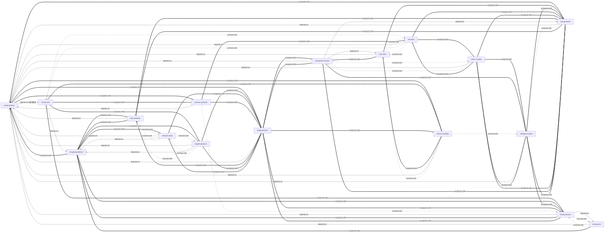

# 《北海的六壬特训班讲义》+《大六壬指南》问答录 — Skill Index

> 本书由 cangjie-skill 蒸馏（两书来源：《北海的六壬特训班讲义》为主纲 + 《大六壬指南》问答录〔北海闲人〕为扩展）, 共产出 **17** 个 skills。
> 处理时间: 2026-08-05

## 关于这本书

- **作者**: 北海闲人
- **两书来源**: 《北海的六壬特训班讲义》（约 2008，内部特训班讲义，案例年代 2004–2009）为主纲；《大六壬指南》问答录（北海闲人，见 [zhinan-wenda/](./zhinan-wenda/)）为扩展，问答录单元合并进既有 skill 并新增专项占类 skill
- **出版年**: 约 2008（内部特训班讲义，案例年代 2004–2009）
- **一句话主旨**: 用"明占类 → 定侧重 → 看显象"三步走，以类神或课体为判断主线，通过辨析课传中的象、动、凶煞完成对人事的准确占断。
- **整书理解**: 见 [BOOK_OVERVIEW.md](./BOOK_OVERVIEW.md)
- **精华长文** (不读全书看这篇): [DIGEST.md](./DIGEST.md)
- **术语词典**: [GLOSSARY.md](./GLOSSARY.md)

---

## Skill 列表 (按主题分组)

### 核心方法论（判断链路，用户指定优先级最高）

- [`sanbu-duanke`](./sanbu-duanke/SKILL.md) — 三步断课法总入口：明占类→定侧重→看显象（断课三看+来意占）
- [`leishen-keti`](./leishen-keti/SKILL.md) — 类神/课体双侧重选择（主线分叉）
- [`kongwang-bianzhi`](./kongwang-bianzhi/SKILL.md) — 空亡与变质辨析（真假校验闸门）
- [`youlu-lilun`](./youlu-lilun/SKILL.md) — 类象之动·"有路"理论（六种引动方式+动象三查）
- [`xiongsha-suduan`](./xiongsha-suduan/SKILL.md) — 凶煞速断（否定式过滤：旬丁/白虎/勾陈/天空，占病四维）
- [`keti-qishi`](./keti-qishi/SKILL.md) — 课体气势阅读法（九宗门→毕法→位次，课体界定+毕法结构）
- [`jixiong-tiaozhi`](./jixiong-tiaozhi/SKILL.md) — 吉凶调制与缩放（四象限+大背景）
- [`yingqi-panduan`](./yingqi-panduan/SKILL.md) — 应期判断（先定迟速，再定日期；古典应期法则）

### 分类占断（应用域，均依赖核心方法论）

- [`shiyun-zonghe`](./shiyun-zonghe/SKILL.md) — 时运课综合断法（安全/收入/婚姻/官运/家运五维）
- [`cailu-panduan`](./cailu-panduan/SKILL.md) — 财禄判断（收入 vs 纯财）
- [`renji-guanxi`](./renji-guanxi/SKILL.md) — 人际关系判断（生合德 vs 刑克穿鬼）
- [`yingpin-gongzuo`](./yingpin-gongzuo/SKILL.md) — 应聘与工作状况判断
- [`shengzhi-jiaxin`](./shengzhi-jiaxin/SKILL.md) — 升职与加薪判断（进达象/增益象/官五要素）
- [`lianai-panduan`](./lianai-panduan/SKILL.md) — 恋爱判断（常法/变法/琐象）
- [`zhongshen-nianyun`](./zhongshen-nianyun/SKILL.md) — 终身与年运课法（年命/三限）
- [`zhinan-zhanbing`](./zhinan-zhanbing/SKILL.md) — 兵占/贼占/逃亡（贼符/游都鲁都/攻守定位/玄武四步）
- [`yunchan-panduan`](./yunchan-panduan/SKILL.md) — 孕产判断（生男女多法/占产定位/产期）

---

## 引用图



图例:
- `-->`  depends-on
- `-.->` contrasts-with
- `===>` composes-with

---

## 推荐学习顺序

(从依赖图的叶子节点开始, 向上; 共 17 个 skill)

1. **sanbu-duanke** — 最基础，没有前置。所有判断的总入口。
2. **leishen-keti** — 依赖 sanbu-duanke，主线选择（类神/课体）。
3. **kongwang-bianzhi** — 依赖 leishen-keti，真假校验闸门。
4. **keti-qishi** / **youlu-lilun** — 两条深化支线（课体细读 / 动态引动），与 leishen-keti 互补。
5. **xiongsha-suduan** / **jixiong-tiaozhi** — 凶煞过滤与吉凶调制，接入任何分类占断。
6. **分类占断九门**（shiyun-zonghe / cailu-panduan / renji-guanxi / yingpin-gongzuo / shengzhi-jiaxin / lianai-panduan / zhongshen-nianyun / zhinan-zhanbing / yunchan-panduan）— 各依赖 sanbu-duanke（+ 各自的校验组合）。
7. **专项占类**（zhinan-zhanbing 兵占/贼占/逃亡、yunchan-panduan 孕产判断）— 属专项占类，须在 sanbu-duanke 之后学习，配合 leishen-keti（玄武/干支定位取类神）、youlu-lilun（动象）、xiongsha-suduan（凶煞分途）、yingqi-panduan（产期/见期）使用。
8. **yingqi-panduan** — 依赖先定吉凶，与全部门类组合，最后学习（老大难）。

---

## 安装使用

本目录是构建产物, 宿主不会从这里加载 skill。要让 agent 真正调用, 把 skill 目录复制到宿主的 skills 目录:

```bash
# 用户级 (所有项目可用)
Copy-Item -Recurse .\books\beihai-xianren\sanbu-duanke $HOME\.config\opencode\skills\

# 或项目级
Copy-Item -Recurse .\books\beihai-xianren\sanbu-duanke <project>\.opencode\skills\
```

---

## 接入 darwin-skill

所有 skill 均带有 `test-prompts.json` (darwin-skill 兼容格式), 可直接接入自动进化:

```
darwin evolve books/beihai-xianren/
```

---

## 审计轨迹

- 候选单元池: [candidates/](./candidates/)
- 被淘汰的候选 (含原因): [rejected/](./rejected/)
- BOOK_OVERVIEW: [BOOK_OVERVIEW.md](./BOOK_OVERVIEW.md)
