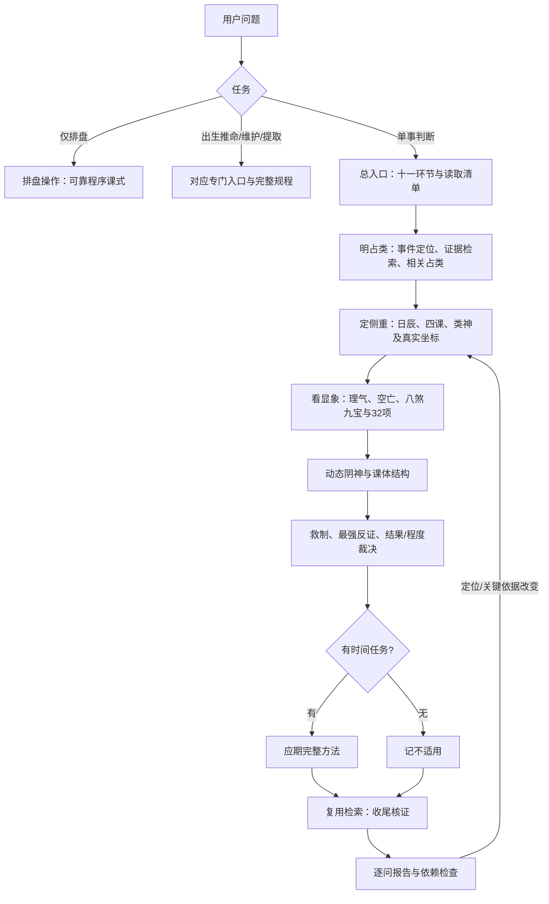

# 大六壬 Skill 结构重整与本地启用

2026-10-23，当前本地版本已升级为 `20261023-modular-03`，详见[加载协议修复与启用说明](加载协议修复与启用说明.md)。下文保留 `20261023-modular-02` 结构重整的历史记录、体积口径及收据；其中旧的文本模式分页核验不能证明原始 stdout 字节哈希一致，03 版已修正并重新验收。活动指针是[liuren-active.json](../../.opencode/liuren-active.json)。

本轮保留北海“明占类 → 定侧重 → 看显象”的主干，用《壬归》等已有理气方法补强对象、位置、施受关系与制救。重点是消除重复与冲突路由，保持可检查的判断过程，不另立竞争流程。

## 目录和唯一入口

```text
.opencode/skills/
├─ liuren/
│  ├─ daliuren/SKILL.md        单事判断与排盘分流
│  ├─ liuren-cases/SKILL.md    检索、复盘与归档维护
│  ├─ liuren-extract/SKILL.md  资料提取维护
│  └─ liuren-tuiming/SKILL.md  出生推命
└─ bazi/
   ├─ bazi/SKILL.md
   ├─ bazi-extract/SKILL.md
   └─ bazi-yingqi/SKILL.md
```

两个分组根没有 SKILL.md。以项目 `opencode.json` 中已有的 `skills.paths=[".opencode/skills"]` 递归发现，配置本身未修改。实际发现返回上述七个名称、正确分组路径及当前正文，旧21个方法名没有恢复为独立 Skill。

[正式总入口](../../.opencode/skills/liuren/daliuren/SKILL.md)直接链接冻结方法包，不依赖逐层兼容跳板。其职责是分流、十一环节、必读清单、条件路由和交付要求。完整方法位于[当前运行包](../../runtime/liuren/20261023-modular-02/entry.md)；可维护源位于[knowledge/liuren-v3](../../knowledge/liuren-v3/entry.md)。维护源不在发现目录，原文档案及备份也不参与自动注册。

## 加载与显式产物



完整判断固定13个基础文件；按环节读取，不开局一次全部注入。12个占类按实际子问选读；时间、风险、规则语义、详细表格和出处分别按触发条件补读。纯查询/归档不加载整套断课与神煞正文。

三个专门入口也采用分段读取：`tools/load-liuren-procedure.py plan liuren-tuiming` 等命令按原章节列出目录，`read` 按分段及页码取得全文。案例维护、资料提取和出生推命分别划为24、18、22段，完整分段拼回原文一致；示例代码块里的标题不会被误当真实步骤。先读方法、边界、补充约束及所执行步骤，原论和案例按争点核查，避免一次注入整份长规程。维护动作以当前分组规程为准，不恢复旧平铺安装路径。

基础文件覆盖：事件定位、证据检索、课位关系、理气、空亡、八煞九宝、32项清单、神煞取用、引擎字段、动态阴神、课体结构、调制裁决、报告检查。没有把基础检查改成可选项；有完整同版本读取记录可以复用。原始来源/案例按争点定位，不通读整库。

显式输出要求保留十一环节的小结，正式报告独立包含：原问与成功标准、角色定位表、主线与方法依据、关键位置和双方状态、实际作用、反证/救制取舍、逐问结论与依赖、应期及边界、实际读取/检索和缺口。输出可核对依据摘要，不要求私下思维草稿。文件读到与方法用对分别检查。

## 重点保留与修正

- **主体定位前置**：以指定患者病程为核心时，默认日干定位患者；为爷爷、晚辈或自己占，不只按亲属六亲换掉事件主体。日支先说明方法所指；患者、病象、治疗和救应分开。六亲参照不能在推断中漂移。相关规则在[定位](../../runtime/liuren/20261023-modular-02/methods/positioning.md)及[疾病](../../runtime/liuren/20261023-modular-02/domains/illness.md)。这是本项目明确修订的执行约束，不冒称整段古籍原文。
- **角色必须实际参与论证**：支取宅/车库，相关上下位置须进入宅的结论依赖；不能只有标签，也不能以“水势不大”替换“是否任何进水”。四课、干支上神、发用与支、六亲序列、关键阴神等明确核查。
- **理气条件完整保留**：月令五气、坐处/十二气的参照、神将与内外战、生克脱耗、刑冲合害、空墓、施受双方、救制通路和有效范围。关系存在不等于实际制住，背景和主判可以被有效反证修订。
- **八煞九宝和32项不删**：清单及不同口径、引擎字段冲突、阳刃/羊刃、病符/丧门/吊客、天地医等差异继续保留。逐项可记录成立、受限、无关、未成立或待核，不能用清单名称代替盘面核实。
- **删除冲突的执行口令**：不再要求调用已撤出的旧 Skill。课体/毕法参考表中“见凶课体即停止、不读位次”的旧指令已修正为继续核位次、状态、救制及反证。九宗门与附加课格分清，不能混列。
- **时间层保留**：流日换旬不改变原局旬空、天将及四课三传。应期有时间任务才完整加载，不能从日期候选反证事件必成。
- **专项边界保留**：传统异性感情常法干男支女，不随提问者性别任意反转；同性关系和未有成熟专法的司法行政等不临时发明万能映射。
- **八字只动目录与元数据格式**：三个正文和参考文件保留原字节。原description含未转义的冒号空格，修为合法YAML字符串，原版本/日期字段移入metadata；没有改八字判断规则。

47个方法、占类和参考文件并非47个自动入口。正文细则集中在所属文件；归档模板、原论原例及历史说明移出普通必读范围。上版完整包逐文件保留，另有755条上版运行段落的源位置/哈希与当前去向记录。该对照证明来源保全并帮助审查，不等于自动证明每条改写的术理等价；主要变更见上述列表。

## 文件体积与读取完整性

下表为实际文件体积，不是模型token账单。没有计入盘式、检索候选、按争点补读的原文，也没有把旧版重复跳转追加读取计入。

| 口径 | 上版 | 新版 | 变化 |
|---|---:|---:|---:|
| 入口本身 | 5.1 KiB | 7.4 KiB | 增加明确十一环节和路由表 |
| 上版开局三个必读 / 新版全部基础必读 | 172.7 KiB | 95.0 KiB | 减少约45% |
| 病程并问时间的对应完整模块集合 | 267.0 KiB | 116.1 KiB | 减少约56.5% |

基础必读的正文字符数约从90,000减到37,371。减少的是共享前言、重复流程、旧入口调用、维护内容和重复解释；实际按环节读取，未强制降低判断报告的详细程度。没有实测模型速度或预测准确率。

加载器示例：

```powershell
python -X utf8 tools/load-liuren-methods.py plan --domain illness --timing
python -X utf8 tools/load-liuren-methods.py read positioning --page 1
python -X utf8 tools/load-liuren-methods.py read shensha-focus --page 1
python -X utf8 tools/load-liuren-methods.py read shensha-focus --page 2
python -X utf8 tools/load-liuren-methods.py read shensha-focus --page 3
```

每页正文不超过7600 UTF-8字节，带文件哈希、页哈希、版本及起止标记。换行归一后分页全文可精确重建。缺任意页不能声明完整；读取清单本身也不证明已读。模型仍须实际按规则判断；没有把文本约束冒称宿主强制门禁。

## 实际验证与剩余边界

- 当前运行包、活动文件集合、版本指针与完整备份哈希核验通过；所有当前方法引用及代码围栏检查通过。旧迁移文件的未闭合围栏仅留在历史档案，没有进入新版执行正文。
- 官方Skill基础验证器检查七个入口通过；Bazi正文与支持文件的保留核验通过。
- 本机 `opencode debug skill` 实际发现七个预期入口，名称、分组路径和正文一致；旧方法别名不再独立发现。Windows换行按内容归一比较。
- 分页器的Unicode长行完整性、依赖路由/循环、文件篡改和旧指针拒绝三个测试通过。对实际病程+应期路线15个模块23页完成完整往返读取校验；32项、九宝、八煞清单数量核验通过。
- 三个专用规程的章节分段完整性和围栏标题识别检查通过；原始资料逐文件哈希保留，未重写专门方法。
- [内容验收题](内容验收题.md)用于下一步模型行为验收。本轮没有调用付费模型，也没有重断用户的爷爷案例；不能据静态检查宣称模型不再漏读、术理判断已必然正确或预测准确率已经提高。

已有OpenCode对话可能仍持有旧入口上下文。重新打开项目后，用新会话加载 `daliuren`，或明确重新加载本版本入口及读取清单；不能只依赖旧聊天已缓存的规则。

## 备份、收据与维护

本轮完整切换前备份位于 `output/六壬技能结构重整-20261023/20261023-modular-02/backup/`，包含七个原入口树、原活动指针和原配置。实际迁出的旧文件在同级 `retired/skills/`。上版运行包原位置保留，且新版 `archive/previous-package/` 为字节一致副本；均在Skill发现区外。

- [OpenCode发现收据](../../output/六壬技能结构重整-20261023/20261023-modular-02/discovery-receipt.json)
- [分页、清单与体积审查](../../output/六壬技能结构重整-20261023/20261023-modular-02/integration-audit.json)
- [官方入口验证](../../output/六壬技能结构重整-20261023/20261023-modular-02/official-validation.json)
- [专门规程分段核验](../../output/六壬技能结构重整-20261023/20261023-modular-02/procedure-audit.json)
- [段落来源与去向](../../runtime/liuren/20261023-modular-02/coverage.json)
- [维护规程](../../runtime/liuren/20261023-modular-02/references/beihai-extend-sop.md)

后续编辑可维护源，另建新版本再切换，不改写本次已启用冻结包。上版一次性激活脚本是历史工具，不再用于新目录。若需回退，应先保存本轮新增改动，再按本轮备份清单恢复文件和活动指针并重新核验发现；不要混用新入口与旧方法包。当前更改范围是本地OpenCode，没有部署网站或服务器。
