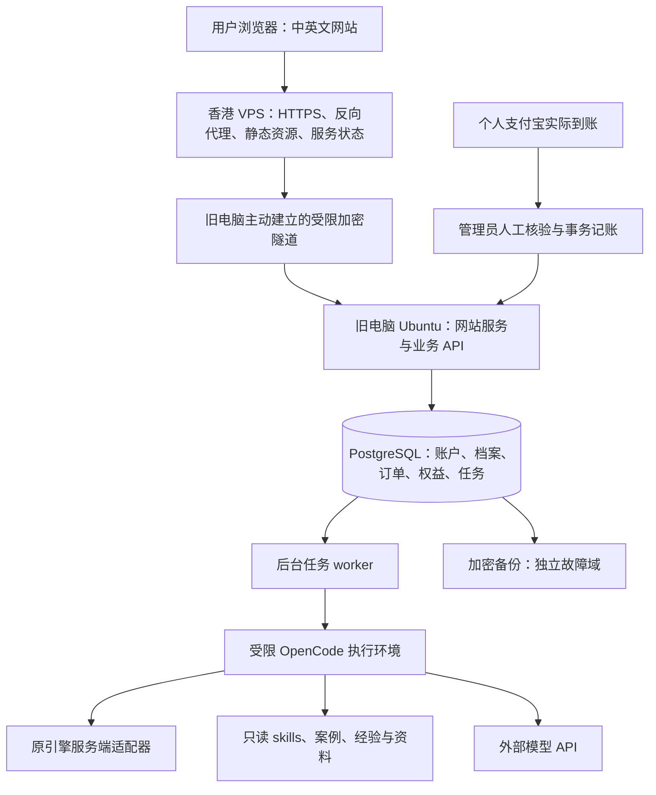

# 问衡 · 六壬问事网站立项方案

版本：v1.3 · 2026-10-15 · 必填出生资料与邀请优惠修订  
项目基础：六壬八字测算  
交付性质：产品与工程立项方案，非已实现功能清单。本文取代 2026-10-14 草案中的首版范围建议；旧文保留为历史记录。

**v1.2 实施覆盖规则：** 用户已明确授权首版采用支付宝个人收款码、人工核对实际到账后自动履约，海外支付仅保留接口；暂时没有模型 API 或 SMTP，先完成安全配置入口。第 14 节以下述人工收款路线为准。旧版涉及官方支付签约、沙箱、回调收件箱和渠道自动退款的内容，作为将来接入正式网关的设计，不再是本轮开发前置条件。生产没有凭据、邮件和真实收款码时关闭收费，不生成演示报告交付客户。实际部署和测试结果另见《首版开发任务与验收》，不以本方案的设计目标冒充完成结果。

## 1. 立项结论

**v1.3 用户确认后的覆盖规则：** 本人性别及公历出生年份改为每次新建／修改问事及自助排盘的必填项；添加其他参与人时也须提供这两项，完整出生日期和本命地支仍可选。历史已购报告不因新规则失效，旧未付款草稿须补齐资料后下单。新增专属链接邀请：新用户注册获得一次基础解读八折优惠（¥29.9 → ¥23.92），对应优惠订单真实付款并成功交付后，邀请人获一张下次基础解读八折券；一次订单一张、不叠加、不折现、不用于追加追问，运营期间无日历到期。归因 cookie 保留 30 天，不等于用券期限。邮件验证使用链接，正式 SMTP 仍待配置；配置说明和真实测试入口均保留。

**建议立项。产品采用“一事一档、首次完整解读、同事件有限追问”；技术采用“香港 VPS 公网入口＋旧电脑 Ubuntu 业务服务＋受限 AI worker”。**

这条路线适合低成本验证业务。现有项目有真实排盘算法、专题 skills 和资料检索，能够复用；网站需要补齐的是账户、事件档案、交易与权益、任务恢复、用户界面和服务端隔离。

首版应当同时包含正时、报数、四柱三种起课方式、有限追问和档案管理。它们是本产品的核心，不能为了省事退化成“填表后购买一份报告”。自动识别问题类型在内部进行，用户无需选择占卜分类。

首版以低成本跑通为目标，产品选择在本文冻结。实际收款权限、引擎与资料的商业使用范围、AI 工具链的质量与成本，在实施中取得证据；不开展与首发无关的大范围渠道或法务调研，也不把尚未申请的商户权限写成已有能力。

### 1.1 已确认需求

| 项目 | 本轮确认 |
|---|---|
| 基础项目 | 以六壬八字测算为主；另一个研判工作流以后再考虑并入 |
| 首发服务 | 大六壬具体问事，AI 自动交付，支持同事件追问 |
| 用户群 | 海外华人和中国大陆用户为主，其他海外用户为辅 |
| 语言 | 中文、英文均支持；建议中文默认，允许用户切换 |
| 部署 | 香港 VPS 对外，主要业务和 AI 工作运行在旧电脑 |
| 输入 | 自由问事；支持必要基础信息及时间、四柱、报数等设置 |
| 收费 | 首发基础 ¥29.9 含主报告和 2 次追问；追加 ¥9.9／3 次，每档最多 8 次追问 |
| 账户 | 注册、密码登录、账户管理、私人档案、导出和删除 |
| 档案数量 | 希望有限额，约 50–100 个 |
| 排盘 | 重做 UI，复用核心计算；考虑开放自助排盘；不提供盘面导出 |
| AI 能力 | 按环境和 skills 自主选择工具，能替用户完成排盘、检索和解读 |

### 1.2 已定首版规则

| 决策 | 首版选择 | 原因 |
|---|---|---|
| 套餐 | 主报告＋2 次追问；加购每包 3 次；每档最多 8 次追问 | 形成 2＋3＋3 的清晰结构 |
| 试验价格 | 基础 ¥29.9，追加 ¥9.9／3 次；首发仅人民币结账 | 降低首次体验门槛，追加包仍保留成本空间 |
| 追问有效期 | 服务运营期间不设日历到期日；按原事件、原课式使用 | 用事件范围与次数控制服务，不让未及时使用的权益自动失效 |
| 账户档案 | 100 个正式档案；另外最多 10 个草稿 | 避免未付费草稿挤占已购档案容量 |
| 自助排盘 | 已登录账户每天 10 次，不含 AI 解读；收费前须验证邮箱 | 无 SMTP 时仍可体验，限制批量调用 |
| 会员 | 首版不做自动续费；复购数据成立后再上固定额度月包 | 当前使用频率和成本尚未知 |
| AI 部署 | 先验证 OpenCode server/SDK 作内部 worker，外层保留可替换接口 | 最大限度复用现有 skills，业务规则独立 |
| 模型与供应商 | DeepSeek 官方 API，`deepseek-flash`，思考模式 `high` | 正式解读的主智能体、子智能体及追问统一配置，实测验收 |
| 盘面 | 精简展示＋可展开专业详情；不提供官方盘面导出 | 兼顾普通用户和熟悉术数的用户 |
| 收款与主体 | 首版个人支付宝码，人工核对实际到账，之后自动履约；海外接口预留 | 用户新增授权，先跑通小规模业务 |
| 品牌与域名 | 问衡 · 六壬问事／Wenheng；计划使用 `wen.qiluhub.com` | 复用已有域名，品牌与业务数据解耦 |

以上按用户授权完成产品决策，作为后续开发基线；不是已部署或已取得外部批准的声明。价格、权益规则和免费排盘额度配置化，购买时保存商品版本。将来调价、换模型或调整政策，不能追溯减少既有权益。

## 2. 对上一版方案的修正

上一版给出了大方向，但作为开发立项还缺少状态设计、收费账本、服务可用性和真实工具验证。此次做以下调整：

1. **三种起课方式全部进入首版。** 现有引擎已经支持；“仅做正时”是排期裁剪，不是技术限制。高级设置默认折叠，减少普通用户负担。
2. **追问属于核心功能。** 从第一版设计事件边界、次数账本、追加购买与硬上限，避免后期改动数据模型。
3. **排盘首选服务端封装原算法。** 不以每单操控浏览器作为长期主架构；原网页主要用于对照验收。
4. **AI 自主调用工具，程序控制业务边界。** AI 不决定收费、不授予权限、不任意改已确认课式。
5. **香港入口要考虑本地故障期间的支付通知。** 当前人工核验路线恢复后对账；未来自动网关接入时再增加轻量可靠收件箱。
6. **原始盘面不导出与客户报告可导出分别设计。** 展示过的数据无法保证不被截图，不能以隐藏按钮冒充保护。
7. **支付准入以本次真实产品为对象。** 不沿用旧调研中“某渠道必然可用”的结论，不把“接受中国个人”误当成“接受本类商品”。

## 3. 产品对象：一事一档，不按消息条数卖服务

一个档案对应一个具体事件，包含原问、背景、已确认范围、起课输入、固定课式、主报告和有限追问。一个档案可以有多个相关关注点，但不能无限扩大对象和事件。

### 3.1 事件范围示例

| 用户输入 | 处理 |
|---|---|
| “这次分手了还能不能复合？” | 建立复合事件档案 |
| “主要阻碍在哪里？” | 同事件追问 |
| “对方现在的态度如何？” | 同事件追问，明确是在既有课式下解读 |
| “如果我主动联系，会有什么变化？” | 同事件的条件展开 |
| “什么时候可能有转机？” | 同事件应期追问；有依据才给时间范围 |
| “我下一段感情什么时候出现？” | 新事件，提示另建档案 |
| “那我今年能不能升职？” | 新事件 |
| “我们已复合，准备结婚，想问婚后如何。” | 进入新的目标和阶段，建议新档案 |
| “补充一点，分手前我们其实异地。” | 追加背景；若需要重新解释，作为同事件追问，不覆盖初始背景 |

范围判定看“对象＋事件＋阶段＋目标”，不能只看“都是感情类”。边界不清时先询问；不替客户下单，也不把新问题偷偷算成原套餐内多次独立起课。

界面表达使用自然话术，例如：“这个问题涉及一件新的事情，需要另建档案。当前档案还能继续讨论本次复合。”不得为了加购而编造玄学理由。

### 3.2 档案建立和锁定

- 第一次输入即保存草稿。未登录用户先保存有过期时间的匿名草稿，登录后归属到账户；支付前完成邮箱验证和归属绑定。
- 付款前可以修改问题、人物、时间和起课方式；修改后生成新的输入版本，旧报价作废或重新确认。
- 支付对应的输入版本固定。延迟支付通知不能绑定到客户后来改写的另一版输入。
- 第一份有效课式保存为本档案的课式快照；重试使用相同输入，已有快照则复用。
- 追问追加新事实，但不更换课式。重新起课会产生新档案，可以关联旧档案，不能覆盖旧报告。
- 系统错误免费修复，保留修订记录。客户付款后发现关键输入填错时，允许在任务尚未开始前取消并重新确认；开始后按明确的重算规则处理，不暗中改盘。

## 4. 用户完整流程

```text
自由输入问题
  → 建立草稿
  → AI 识别事件与缺少的信息
  → 默认自动设置，或展开正时／报数／四柱设置
  → 回显“本次解读的问题＋必要输入＋价格与权益”
  → 注册／登录并确认
  → 支付
  → 自动排盘、检索、研判、核对
  → 主报告与档案对话
  → 同事件追问／购买追加包／归档整理
```

允许用户先改排盘设置再问事，也允许只输入问题由 AI 补全流程。这两条入口使用同一份输入契约和确认页，避免形成两套业务逻辑。

### 4.1 普通用户路径

首页先呈现一个输入框：“你现在最想弄清楚什么？”示例用于帮助表达，不要求选择类别。默认取用户确认本次输入的当前时刻，统一按北京时间排课，并同时显示用户所在地时间；时区无法可靠确定时请用户确认。本人性别和公历出生年份必须填写；按需添加其他参与人，添加后也必须填写这两项。完整出生日期和已知本命仍可留空，不要求完整八字资料。

AI 回显一句问题范围，例如：“本次解读：你与这位前任在未来一个月内是否有复合机会，以及影响结果的主要因素。”期限是用户提供或确认的，不能由系统默默补写。

### 4.2 熟悉术数的用户路径

“排盘设置”展开后可选择模式、输入参数和必要高级规则。前端校验格式，后台校验组合与引擎支持范围。付款前展示实际采用的输入和设置。

| 模式 | 网站需要的输入 | 实施注意 |
|---|---|---|
| 正时 | 日期、时间、输入时区；默认确认时刻 | 统一转换为北京时间；用户确认时固定，排队时不更新 |
| 活时报数 | 日期或明确时间基准、正整数报数、输入时区 | 以北京日期为基准；1=子、12=亥、超 12 循环；不接受 0、负数、小数 |
| 四柱 | 符合引擎契约的年干支、月支、日干支、时支、月将 | 不是任意八字文本都可直接传入；不伪造历史公历日期 |
| 高级规则 | 贵人方式、昼夜贵人、涉害、月将取用 | 默认值固定且可见，修改进入输入版本 |

真太阳时可列为后续高级选项。现有页面有该功能，但其跨地区、历史时区与边界结果尚需验证；不把“有输入框”当成已完成全球适配。

### 4.2.1 时间与高级规则的首版契约

- **取时点：** 默认由服务端记录用户点击“确认本次输入”时的 UTC 时刻并冻结；确认回执展示精确时间。后续付款、排队、重试不重新取时。手动指定时间和自助盘转入采用用户已确认的原时间。改输入产生新版本，不能让旧付款绑定新版本。
- **排课时区：** 首版统一 `Asia/Shanghai`。浏览器提供用户的 IANA 时区供显示和手动时间输入，后台转换为 UTC，再转换成北京钟面传给引擎；同时保存原始当地时间、IANA 时区、UTC 和实际排课时间。确认页明确“按北京时间排课”，海外用户也能检查转换结果。夏令时重复时刻需确认 UTC 偏移，不存在的当地时刻拒绝；不能把服务器所在地或浏览器不带时区的字符串默认为用户时间。
- **选此规则的理由：** 当前引擎使用主机本地日期对象，历法节气存在中国时间口径。固定引擎运行时区能保留已验证行为。首版不提供“按任意所在地钟面直接排课”或真太阳时选项；它们是后续经专项验证的规则版本，不宣称北京时间是唯一术数流派。
- **日时边界：** 沿用当前六壬引擎与历法库的零点换日口径；23:00 已进子时，但日柱至 00:00 才换。时干由同一库整体计算，不能再按显示日干手工重算。付款确认、报告和样例须与这一版本一致。
- **高级默认值：** 月将“中气换将”、贵人“甲戊庚牛羊”、昼夜“自动选择／卯昼酉夜”、涉害“孟仲季”。自动昼夜以引擎的卯辰巳午未申为昼、酉戌亥子丑寅为夜。专业用户修改支持的规则后需重新确认并保存设置版本。

### 4.2.2 报数、四柱与人物资料的首版契约

- **报数边界：** 支持十进制整数 1–999999999；拒绝 0、负数、小数和超范围值，不自动取绝对值或截断。对应地支索引为 `(n−1) mod 12`：1 子、2 丑、…、12 亥，13 回到子。数字文本及规范化结果都保存。
- **报数取时：** 采用引擎既有代表时刻：子 00:00、丑 02:00、…、未 14:00、亥 22:00。在已确认的北京基准日期上换时，月将等仍由引擎按该规范化时间计算；跨交节边界也以实际传给引擎的时间为准。界面在付款前显示“报数 8 → 未时 14:00”等结果。旧页面的 0 值异常不作为网站兼容目标。
- **四柱必填：** 年干支、月支、日干支、时支、月将；验证年／日干支是否合法，月干和时干按引擎契约推导。只有缺少必要字段时请用户补充，不能凭一段不完整八字猜出真实公历日期。
- **缺少真实日期：** 允许纯四柱起课。真实日期字段为空，不能用技术占位日期生成节气、年龄、行年或公历应期；如引擎内部必须填日期，只存在于隔离适配器，并明确阻断这些派生结果。四柱与用户另外提供的实际日期矛盾时先澄清，不静默覆盖其中一方。
- **参与人：** 使用“本人／对方”等角色代称；性别、出生年、出生日期、本命分别保存来源和未知状态。只有生肖或本命不能反推出生年份；仅给年龄时不能擅自判断周岁／虚岁。已知本命可使用，行年必须具备对应起算资料和真实占年。缺资料时省略有关判断并说明，不影响其他可完成的解读。
- **适配隔离：** 参与人资料保存在网站领域记录，复制后交给引擎。不能继承现引擎四柱分支清空 `user` 的副作用，也不能把占位日期或猜测值当成 AI 的事实。

### 4.3 生成过程

用户看到“等待处理／准备资料／正在解读／核对结果／已完成”。进度来源于实际任务事件，不显示假百分比，也不暴露工具原始输出或模型内部思考。

生成采用后台任务，关掉网页不会中止。重新打开同一档案可继续查看状态。首次等待时间在试运行后按实际分位数展示，立项阶段不承诺“十秒出结果”。

主报告先完成检查再交付。首版可以先展示进度，最终一次展示完整结果；以后可对已审核段落流式呈现，避免客户先看到随后被撤回的错误结论。

## 5. 轮次与权益规则

### 5.1 一次追问的定义

**一次成功保存并可供客户读取的同事件实质解答，消耗一次追问。** 主报告单独计算，不占追问次数。用户一段文字含多个紧密相关的小问，可以合并回答；多个独立事件则澄清或分档，不能只靠问号数量计费。

| 情况 | 是否消耗追问 |
|---|---|
| 正常同事件实质回答 | 是 |
| 已完成约定分析，依据不足而给出有解释的“无法确定” | 是；购买前说明可能出现此结果 |
| AI 要求补充资料、确认指代 | 否；与原提问组成同一逻辑轮次 |
| 范围外问题提示、剩余次数查询 | 否 |
| 工具失败、超时、模型错误、内部重写 | 否 |
| 修正系统自己的错误 | 否，走修订流程 |
| 刷新、重复提交、网络重连 | 否，不创建第二个回答 |

免费澄清也要限额：建议付款前最多 2 次 AI 澄清，仍不足时改用明确的补充表单；已付费轮次最多 2 次补充交互，不能借此无限聊天。次数和输入长度应按试运行调整。

### 5.2 追问额度和硬上限

基础含 2 次，加购每包 3 次，最多加购两包。**总计最多 8 次追问，另含 1 份主报告。**

购买包数按非全额退款的追加订单计算：累计全额退款的订单不占包数，部分退款仍占一包，最多保留两笔非全额退款追加订单。每次加购还须满足“净授予次数（含已消耗次数）＋已预留购买次数＋本次 3 次 ≤ 8”。因此整包退掉后可以重新购买，已经使用的次数不会因退款清零；剩余可授予空间不足 3 次时，不出售超出上限的整包。

界面必须区分：

- 还有额度：允许发送。
- 额度为 0、按上述退款后口径仍可完整购入 3 次：显示追加包。
- 净授予已满 8 次但尚有余额：禁止继续加购，仍可使用剩余次数。
- 已成功消耗 8 次：仅阅读、导出、反馈；不继续卖本档案追加包。
- 主动归档：只是整理，可以重新打开继续使用剩余次数，不撤回权益。

**不采用 30 天过期制。服务运营期间，随基础服务包含及另行购买的追问均不按日历时间失效。** 仍须围绕原事件、使用原课式；时间变久或补充新背景本身，不足以强制另购。事情已经结束后形成新目标，或换了具体事项、关键对象，才另建档案。范围有争议时先澄清，不扣次数。

不承诺网站永久运营。计划停运时提前至少 30 天公告，并提供报告导出和未用付费追加次数退款；突发停运则在恢复处理能力后优先对账和退款。基础套餐附带的 2 次追问没有独立现金退价，但不影响系统未交付或质量问题的基础订单售后。运行服务迁移或更换模型时承接原权益，不让客户重新购买。

没有到期日，因此故障无需计算“顺延几天”：未成功交付不扣次，原余额继续保留。用户不愿等待时，可申请退还未用的付费追加次数。暂停新销售不能撤销已有客户的交付义务。

### 5.3 账本与扣次

```text
校验身份、档案范围、可用状态、余额、硬上限
  → 原子预留 1 次
  → 创建唯一任务
  → 生成与检查
  → 保存回答并将预留转为消耗
  → 失败则释放预留
```

可用次数＝已授予次数－已撤回次数－已消耗次数－已预留次数。回答落库与正式消耗在同一事务内完成；扣的是交付，不是网页是否刚好在线。

同一档案同一时间只允许一个生成任务；不同档案可按容量并发。重复请求有幂等 ID。加购结账时也要预留购买名额，避免两个浏览器标签同时购买突破 8 次上限。

优先消耗基础附带次数，再按购买顺序消耗追加次数，并保留每次消耗的来源订单。追加包按未使用次数占该包总次数的比例退款；退款成功才最终撤回对应权益，处理中先冻结，失败则交由对账恢复或继续处理。部分退款精确到分，尾差归最后一次退款，总退款不超过实付。

## 6. 收费模式与试价

### 6.1 模式选择

| 模式 | 适配度 | 建议 |
|---|---|---|
| 按消息单次付款 | 每次支付摩擦大、小额固定手续费高，用户容易纠结澄清是否扣钱 | 不采用 |
| 一档基础费＋追问包 | 与一事一议一致，成本边界清楚 | 首版采用 |
| 次数钱包／储值余额 | 跨档更灵活，但退款、资金余额和规则更复杂 | 首版不做 |
| 固定额度月包 | 适合稳定复购用户，需要验证使用频率 | 后续评估 |
| 无限会员 | 难以控制长对话、批量问事和代理滥用 | 不采用 |

### 6.2 首轮固定试价

| 商品 | 首发人民币价 | 内容 |
|---|---:|---|
| 基础解读 | ¥29.9 | 一件事、一份主报告、2 次追问 |
| 同档追加包 | ¥9.9 | 3 次追问，最多购买两包 |
| 一档全部用满 | ¥49.7 | 一份主报告＋8 次追问 |

首批 100 个成功交付的基础订单采用上述价表；到第 100 单或上线满 30 天时复盘，以先到者为准，复盘不自动触发涨价。试价期间不做会员、自动续费、复杂折扣和差别报价。基础费覆盖完整工作流与附带追问，追加包在同一课式和既有上下文上继续，保留较低单次价格。

¥29.9 是降低初次尝试门槛的经营判断，尚无真实转化数据；¥69 暂不作为基础售价。试运营优先用邀请与自然流量验证，不预设买广告获客仍能盈利。以后如转化、复购和质量支持，可单独测试新客基础价 ¥39.9；先不要同时改价格、模型和服务范围。

首发只展示人民币实际支付金额，中英文界面使用同一价表；英文不等于美元结账。国际卡和美元留到真实海外收单接通后再启用，届时可从独立地区价 $4.99／$1.99 试算，当前不作为可购买商品展示。所有金额由服务端生成，不按前端汇率临时算价。

### 6.3 后续便宜不等于只看 API 标价

所有成本须包含：主模型、子任务、上下文摘要、检查重试、失败调用、工具服务、支付费用及直接售后成本。完整历史存档，不意味着每次都把完整历史送给模型。

追加包最低价格可以按下式估算：

```text
P ≥ (n × C95 + f + R) / (1 − r − m)

n：追加包次数
C95：实测单次追问成本的第 95 百分位预算
f：每笔支付固定费用
R：这笔追加包的其他直接成本与异常准备金
r：比例支付费用
m：希望保留的贡献比例
```

不能把 P95 当作绝对上限；仍需单任务预算、重试上限和账单对账。

以下仅为敏感性计算，**5%＋¥1 是演算假设，不是支付宝或任何渠道的真实报价**。追加包 ¥9.9，3 次，另预留 ¥1.5：

| 每次实际模型及工具成本 | 三次成本 | 扣假设支付费与准备金后的贡献 |
|---:|---:|---:|
| ¥0.8 | ¥2.4 | 约 ¥4.51 |
| ¥2 | ¥6 | 约 ¥0.91 |
| ¥5 | ¥15 | 约 −¥8.10 |

同样假设下，若希望留 20% 贡献，单次追问预算需约不超过 ¥1.64。首版验收目标定为：单次实质追问全部模型与工具成本 P95 ≤ ¥1.5；基础主报告加附带 2 次追问全部使用后的成本 P95 ≤ ¥6。它们是预算目标，不是已测得的成本，也不是每次调用的绝对上限。

例如基础包模型与工具成本为 ¥6、支付费用仍按 5%＋¥1、另留 ¥3 售后准备时，¥29.9 约余 ¥18.41 贡献。获客、固定服务器、开发维护和税费还要扣除，不能把它误称净利润；低频订单时，固定成本也可能让项目整体亏损。

费用统计累计所有工具循环、子智能体、思考输出、摘要和失败重试，依据供应商实际账单校对。连续样本的 P95 或失败率超出预算时，优先优化无效上下文和重试，必要时暂停新单／追加包销售，再调整新订单价格；不能静默降低已购客户的模型档次、吞次数或拒绝履约。保留当日费用阈值与异常告警，但不因一单异常就自动永久停站。

### 6.4 会员何时适合推出

先观察至少 60 天及真实复购：多少人一个月内有第二件事、追加购买率、实际追问使用数和退款原因。若确有高频客户，可试验“每月 2 或 3 个新档案，每档固定追问”的月包。首版不设追问到期日，测算时要保留尚未使用的权益对应的未来交付预算，不能把未使用直接当利润。

月包可以先手动续购，之后再做自动续订。自动续订必须另外实现取消、扣款失败、下期生效、已生成档案不消失、剩余额度处理。会员不能绕开单档硬上限。

## 7. 账户与档案

### 7.1 账户基础功能

首版包含邮箱注册与验证、密码登录、退出、忘记密码、修改邮箱与密码、会话注销、账户删除申请。密码交给成熟认证组件处理，不自制密码协议；管理员启用二次验证。

昵称可选，不要求实名、身份证或手机号作为通用入门门槛。涉及具体支付或运营地区要求时再按实际要求增加，不能因为排盘顺手收集无关资料。

### 7.2 档案管理

支持标题改名、搜索、按状态筛选、收藏或归档、查看消费记录、导出、删除。改标题不改变原问和课式。归档只是整理，仍占容量。

确定为 100 个正式档案，已付款待交付也计入；最多 10 个独立草稿，7 天未操作可清理并提前说明。正式档案不因长期未追问自动删除，也不承诺网站停运后永久保管。

付款前检查并预留档案名额。容量满时可继续追问已有档案、导出或删除旧档案；不能收了新档案的钱才提示容量不足。删除不是退款操作，退款也不应默认删除客户已取得的报告。

### 7.3 导出与删除

首版支持文本／Markdown 导出，PDF 作为紧随其后的功能。导出包含用户自有输入、确认的问事范围、主报告的公开文本、追问与回答、时间和服务信息。

原始课式 JSON、完整盘面表、内部工具输出、资料全文、提示词不进入官方导出。报告应按区块区分文字解读和盘面呈现，不能只从整页 HTML 打印后宣称没有盘面。对用户自己输入的时间、四柱和数字，不把它们冒充平台专属数据。

普通删除先隐藏档案、取消正在执行的任务、释放未消耗预留，并标记不可再写入；内容进入 7 天回收期，期满才永久清理。“立即永久删除”跳过回收期。恢复需要重新检查容量，保留原权益规则，不恢复已经退款撤回的权益。

删除确认页显示剩余次数及预计退款：未交付主报告的基础订单取消后申请退款并撤回附带权益；主报告已交付，不因删除自动退基础费，质量售后另行处理；另外购买的追加包按未使用次数比例申请退款，正在运行的轮次先完成取消与交付状态核对。比例以该包实付金额计算，金额精确到分且不超过实付；永久删除前必须持久保存必要的退款待办与交易关联，不能用删除操作吞掉未处理的付费权益。附带追问不单独折现，删除前明确告知，不能把单纯归档当成删除。

备份中的数据随轮换在约定期限内消退；恢复备份时重放删除记录，防止已删档案复活。依法或为交易争议保留的最小财务记录与解读内容分别管理，保留期限写入正式政策。

## 8. 自助排盘与盘面权限

自助排盘作为独立入口，注册并验证邮箱后可使用。一次仅调用确定性引擎，不运行昂贵的全套 AI；达到日限额后提示次日再用。初始建议每天 10 次，后续根据使用与抓取情况调整。

自助排盘结果可转为问事档案，复用当前课式；用户确认的是“解读这张盘”，不能转入后偷偷改成当前时刻。自助盘可短期保存，再由客户选择纳入正式档案，避免无限免费占用存储。

网站重做模式选择、日期时间、人物资料、高级设置和盘面展示；移除原站导入整库、导出规则、内部存档、调试与维护功能。核心算法在服务端运行，前端只接收展示白名单。

**可交付的限制是“不提供盘面下载／原始数据导出”，不能承诺“完整盘面显示出来但绝对不可复制”。** 用户能够截图、抄录或获取浏览器已接收的展示信息。右键禁用、水印和隐藏 DOM 都不能建立这种绝对保护。

**首版确定采用“精简盘面＋可展开专业详情”。** 默认显示起课方式、确认时间／时区、四课三传和必要标签；展开后提供天地盘、天将及本次相关的专业细节。自助排盘与付费档案使用同一套有权限控制的展示组件。禁止的是官方盘面下载及原始 JSON 导出，不要求所有完整盘面数据永远不离开服务端；展示字段会发到浏览器，可以被用户保存。引擎源码、完整内部对象、提示词、资料库和执行环境保持服务端私有。

## 9. 网站页面与视觉方向

### 9.1 信息架构

| 页面 | 核心内容与动作 |
|---|---|
| 首页 | 自由问事输入、服务说明、样例报告、价格入口、中英文切换 |
| 新建问事 | 原问、必要澄清、起课设置、范围回显、价格与权益确认 |
| 自助排盘 | 三种模式、参数、简化盘面、转入解读 |
| 结账 | 商品、档案摘要、币种金额、支付方式、不按日期失效及退款说明 |
| 档案详情 | 主报告、追问对话、剩余次数、同事件范围、盘面摘要、追加包 |
| 我的档案 | 搜索、状态筛选、容量提示、归档、导出和删除 |
| 账户与订单 | 邮箱密码、活跃会话、订单、退款进度、隐私与删除 |
| 帮助和服务状态 | 如何问事、什么算追问、异常说明、支持入口 |
| 内部运营台 | 支付对账、任务异常、费用、质量抽查、资料版本和服务开关 |

### 9.2 UI 风格

采用“现代阅读界面＋克制的东方细节”：纸白底色、墨青主色、少量朱砂强调。品牌定为 **问衡 · 六壬问事**，英文 **Wenheng**，说明语“把一件事，问清楚”。背景 `#F6F4EE`、正文 `#182A28`、主操作 `#205C50`、强调 `#A84532`；实现时检查文字和交互对比度，不做复杂视觉动效。

首发域名目标为 **`wen.qiluhub.com`**，复用维护记录中的既有 `qiluhub.com`，暂不购买新域名。本轮没有核验 DNS 可编辑性、配置路由或检索商标；实施时检查子域名是否已占用。名称、Logo 和域名均作展示／部署配置，不嵌入订单标识、事件类型、权益规则或任务协议。

标题可用清晰的宋体风格，正文用易读黑体／系统无衬线；英文正文采用系统字体。字体本地托管或使用系统回退，避免大陆用户因外部字体服务导致空白和延迟。不要首屏塞大段术语、复杂罗盘动画或虚构准确率与客户数量。

首页的第一视觉重点是问题输入。价格和包含权益用一句话说明。报告采用结论、主要依据、条件与未定项的阅读结构；术语有解释，但不让普通用户面对整套工具清单。

### 9.3 关键页面线框

```text
首页／新建问事
┌ 品牌        自助排盘  我的档案                 中 / EN  账户 ┐
│                  你现在最想弄清楚什么？                    │
│  [自由描述事情、背景，以及你最关心的结果                 ] │
│  起课：确认时刻 · 按北京时间排课                修改设置 ▾ │
│  [继续，确认本次问事]                                     │
│  示例报告    服务包含什么    收费说明                      │
└──────────────────────────────────────────────────────────┘

档案详情（桌面）
┌ 我的档案 ───────────── 当前事件 ───────────── 本次信息 ────┐
│ 搜索／状态    主报告：直接回答、依据、条件        范围摘要 │
│ 档案列表      追问与回答                         固定设置 │
│               [继续问这件事……              ]    盘面展开 │
│               剩余 2 次 · 同事件可用 · 发送      消费记录 │
└──────────────────────────────────────────────────────────┘
```

移动端优先：档案列表收进抽屉，本次信息用折叠区，追问输入与剩余次数固定在容易找到的位置。支持 360px 宽度、键盘操作、清晰焦点和约 44px 触摸目标。错误在对应字段旁解释，不能只弹一闪而过的提示。

额度用尽显示加购，达到硬上限显示只读状态，两者不能都叫“已结束”。加载、空档案、失败、退款中、删除中、本地离线都需要独立界面文案。

### 9.4 中英文

所有流程双语：注册、支付、生成进度、报告、错误、订单和售后。界面语言与报告语言分开保存；切换界面语言不触发第二次模型生成。

英文报告使用统一术语表并以自然语言解释术语，不逐字机械翻译。首版一份报告选一种输出语言，若日后支持翻译既有报告，翻译另有预算并保留原报告，不能把翻译误算为问事追问。

## 10. 总体部署架构



### 10.1 香港 VPS 的职责

- 固定域名和 HTTPS，反向代理到旧电脑的本地业务服务；静态资源可直接在香港提供。
- 对请求大小、连接数、登录尝试和明显滥用做基础限制。
- 旧电脑不可用时展示维护页与真实服务状态，停止新结账，保留帮助入口。
- 自动支付接入后增加轻量通知收件箱；当前人工收款版不部署伪回调。
- 只保存履行上述职责所需的数据，不把香港变成第二套用户档案主库。

支付收件箱可用小型服务加 SQLite 或同等级可靠存储。它是明确的轻量例外，不承载模型或知识检索；收件箱也需要容量告警和备份。

### 10.2 旧电脑的职责

Ubuntu 内运行网站业务 API、账户服务、PostgreSQL、任务队列、排盘适配器、资料检索、AI worker 和导出任务。外部模型 API 承担模型推理，“本地运行 AI 工作流”并不意味着在旧电脑部署大模型权重。

不需要因使用 AI 就购买 GPU。当前资料索引和确定性排盘的负担远小于本地大模型推理；实际容量取决于 worker、上下文、并发、数据库和网络，需要测试。

维护记录载明旧电脑为 i7-9750H／16GB，Hyper-V Ubuntu 配置 4 vCPU、动态内存 2–6GB、32GB 虚拟盘，且已有其他业务；香港约 3.8GiB 内存、20GB 系统盘。**本轮没有重新连接服务器核验，以上仅作容量规划起点。** 不把整机内存视为本项目独占。

本项目应有独立目录、系统账户、数据库与角色、容器网络、隧道端口和域名；保留已有业务。生产构建尽量在开发机或 CI 完成，不让线上旧电脑同时编译前端和处理客户任务。

### 10.3 连接与大陆访问

优先沿用已验证的“旧电脑主动发起受限反向 SSH”方式，为本项目单独配置服务和回环端口；具体端口实施时检查，不能直接复用已有网站端口。固定主机指纹、自动重连，隧道仅转发本项目入口。

公网只开放网站所需入口。数据库、OpenCode、MCP、管理端口与原排盘静态服务均不直接对外。应用只信任受控反向代理传入的来源 IP 头。

先评估香港直接 HTTPS 入口的大陆与海外实际表现，再决定 CDN。不能保证“加 Cloudflare 就会让大陆更快”；字体、脚本和关键页面避免依赖大陆访问不稳定的第三方资源。首版不必强行引入全球多地域架构。

### 10.4 这条路线的真实可用性边界

旧电脑断电或家庭网络断开时，香港入口仍可显示静态页、接收支付通知，但账户查询、历史档案和新解读可能暂时不可用。轻量回调收件箱不会自动让整个网站高可用。

前期可以接受这一成本取舍，前提是明确状态、暂停结账、持久保留任务并提供补交或退款。若以后要求本地故障期间仍能登录和查看档案，应把账户、订单、报告数据库和轻量 API 迁到云端，旧电脑保留 worker；现有模块边界应让这一步可迁移。

## 11. AI 工作机制

### 11.1 网站系统与 AI 各自负责什么

| 网站程序确定 | AI 在授权范围内决定 |
|---|---|
| 身份、档案归属、付费权益、输入版本 | 问题的实际类型、需要澄清什么 |
| 哪些工具可以使用、可访问哪一档 | 选择相关 skill 和检索词 |
| 是否允许新课式、课式是否已固定 | 对工具事实和资料进行解释 |
| 任务时限、预算阈值、并发和重试次数 | 同一事件内如何展开追问 |
| 扣次、退款、结果保存和权限 | 对支持、差异、冲突和未定项形成公开判断 |

AI 的自主性体现在方法与工具选择；收费权限和数据权限不能依赖模型自觉遵守。

### 11.2 推荐执行引擎

OpenCode 官方提供 headless server、TypeScript SDK、会话、异步请求、SSE、取消、skills 和自定义工具，符合复用现有技能的方向。[S1–S4]

建议网站后端通过统一 `AgentRuntime` 接口调用内部 OpenCode worker。业务库使用自己的任务、消息和报告格式，不把 OpenCode Session／Part 直接作为公共 API。以后若换为自建工具调用循环，可以替换适配器，账户和收费部分无需重做。

选择 OpenCode 的前提是通过专项验证。官方具备会话能力不等于提供网站多租户授权、精确费用硬上限或断电自动续跑。SDK 与服务器锁定同一套经过测试的版本，按实际 OpenAPI 契约调用，避免跟随升级改变生产行为。

自建工具调用循环作为替代：工具面更小、预算控制更直接，但 skills 加载、子任务、上下文压缩和恢复都需自己实现。立项阶段先验证 OpenCode，不同时开发两套生产运行时。

### 11.3 工具范围

给服务任务的工具应是明确功能，例如：读取当前档案、确认缺失输入、计算固定课式、提取相关盘面事实、搜索案例、读取出处、读取批准的技能、提交候选报告。

工具根据后台绑定的用户和档案身份工作；模型不能通过传入任意 `user_id` 或路径读取别人的档案。知识库只读。禁止客户任务使用任意 Shell、改代码、更新知识库、调用支付退款、访问管理服务或随意联网。

当前项目依赖浏览器起盘和子智能体调用的文字指令需要做服务化适配：保留断课方法，替换运行接口，并记录真实调用。`liuren-cases` 的子智能体定义与权限须在项目内补齐或改成经验证的专用工具，不能仅凭 SKILL.md 写着“调用”就认为已配置好。

### 11.4 请求隔离

首版建议每个运行任务获得独立工作区和受限进程／容器，知识库按固定版本只读挂载。使用独立生产配置，不继承开发电脑的全局插件、个人凭证和文件访问权限。

初始 worker 并发从 1–2 开始，按实测调整。同一档案串行。OpenCode 的多个 session 是逻辑会话，不自动构成隔离边界；共享进程优化只能在跨档读取、工具路径和事件串流测试通过后考虑。

任务的可恢复事实保存在业务库，包括确认输入、课式、已有答案、依据索引和摘要。OpenCode 的本地会话存储可以辅助恢复，但不是唯一的客户档案。

### 11.5 追问的成本与一致性

追问加载固定课式、当前事件范围、已确认事实、之前结论摘要、必要历史以及本次问题；按需检索。完整档案仍保留，但不把所有工具结果、全部书籍和历史对话重复送入模型。

信息发生变化时明确说出“这是新增背景导致的解释调整”，不能偷偷改原报告。正式主报告、实质追问和参与判断的子智能体采用同一已验收模型及思考级别；格式整理等辅助任务可单独配置，但不能未经验证改变核心判断质量。

费用记录涵盖所有模型调用及失败重试。OpenCode 的步骤上限不是金额上限；外层还要限制运行时间、调用次数、工具次数、输出规模和预算。达到限制时进入失败或待处理状态，不能把“来不及完成”的总结当收费报告。

若需要严格的金额硬上限，必须通过模型网关或经过验证的运行时拦截，在每次请求发出前按输入和最大输出预留预算，并覆盖子智能体、摘要压缩与重试。仅监听事后用量再中止，属于预算阈值与超限中止，不能保证不超额；取得完整调用拦截能力前，费用模型须预留这一偏差。

### 11.6 首个生产模型与调用渠道

**选定 DeepSeek 官方 API 的 `deepseek-flash`，开启思考模式，`reasoning_effort: high`。** 截至 2026-10-15 官方对应 DeepSeek-V4.1-Flash。主智能体、实质判断子智能体和后续追问显式配置同一模型与级别；不依赖开发机默认模型，也不默默将追问降档。[S11–S13]

首发只接一个供应商，直接使用官方账户，避免多层转发影响成本和故障定位。模型暂不可用时保留队列、重试或退款；不自动切换未经验收的替代模型。项目已有 `opencode.json` 不能证明生产模型或专用 agent 已配置，这些仍须在实施时显式落实。

官方当前高峰价为每百万 tokens：输入未缓存 ¥2、缓存命中 ¥0.04、输出 ¥8，非高峰价减半。预算先按高峰且输入不命中缓存计算，不依赖促销或闲时。示例：整个任务累计 10 万输入、2.5 万输出时，模型费用为 ¥0.40；这是按价表演算，不是本项目实测成本，仍须汇总思考输出、子任务及全部重试。[S11]

工具调用验收必须覆盖思考模式连续调用和历史 `reasoning_content` 的完整回传；后者只在受控运行环境与供应商间传递，不展示给客户、不进入普通访问日志。[S12] 官方 9 月 10 日公告说明 `deepseek-v4-pro` 自 9 月 14 日亦路由到 V4.1 Flash；当前不能把这个名称当独立高配模型，即使价表仍保留旧条目。[S13]

选型确定不等于解读质量已证明。上线前以同题样本检验：真实完成必需工具、四课三传一致、引用可查、不会将不相关案例直接采信、追问沿用原盘、报告可理解、成本和时延符合预算。普通、复杂和缺资料问题均须覆盖；失败先修工作流并复测。若仍不达标，再发布新的模型决策版本，不能以“模型便宜”为由降低交付门槛。

## 12. 技术栈安排

采用一个主代码库、清晰模块划分和少量独立进程，适合个人维护。

| 层 | 推荐 | 选择依据与边界 |
|---|---|---|
| 前端与业务 API | TypeScript＋React＋Next.js，自托管 Node | 表单、账户、档案和双语页面统一；后台长任务不在 HTTP 请求里执行 |
| 样式与组件 | Tailwind CSS＋可维护的可访问组件库 | 统一状态、表单和响应式设计；组件库版本在原型时固定 |
| 认证 | 成熟邮箱密码认证库，优先评估 Better Auth | 登录、验证、重置、会话等要做适配验证；本轮未完成该库当前文档验证，不以名称代替选型验收 |
| 数据库 | PostgreSQL 16 或实施时验证的受支持版本 | 交易、权益和任务需要事务；与已有网站分库分角色 |
| 查询／迁移 | Drizzle 或同类轻量 SQL 工具，实施时选定一种 | 保留数据库唯一约束和事务，不仅依赖应用层检查 |
| 后台队列 | pg-boss＋PostgreSQL | 支持持久队列、重试、并发，首版减少额外 Redis 运维 [S6] |
| AI 运行 | OpenCode server＋SDK，外置运行时适配层 | 私网运行、锁版本、受限工具 [S1–S4] |
| 排盘 | Node.js 封装现有 JavaScript 引擎 | 复用算法，解除 UI 与全局变量依赖 |
| 检索 | 先保留确定性规则，移植为服务端结构化查询 | 过渡可验证 PowerShell 7；小语料不急于上向量数据库 |
| 进度 | 自有事件接口＋SSE，失败可轮询 | 客户只订阅自己的任务；代理须支持无缓冲与心跳 [S5] |
| 文件 | 本地受限目录＋加密异机备份 | 正文主要存数据库；导出文件可重建，短期留存 |
| 香港入口 | Nginx；小型回调接收服务及可靠本地存储 | HTTPS、代理、限流、离线页与通知持久化 |
| 部署 | Ubuntu＋Docker Compose；隧道由 systemd 管理 | 两台机器以内可维护，不引入 Kubernetes |
| 验证 | 单元／契约测试＋Playwright 端到端测试 | 重点验证交易、跨档访问、模式对照、断线恢复 |

Node 建议采用受支持的 LTS 版本，并与锁定的 OpenCode、Next.js、pg-boss 兼容；本次读取的 pg-boss 文档要求 Node 22.12+、PostgreSQL 13+，实际实施仍锁定依赖与镜像摘要。[S6]

Next.js 官方支持自托管并建议前置反向代理；SSE 不应被代理缓冲。账户与私人报告响应禁止公共缓存，公开首页和静态资源可缓存。[S5]

这些是架构选型，不要求同时引入所有组件的最新版本。以兼容、可升级和低维护成本为准。

## 13. 数据模型与服务状态

### 13.1 主要数据对象

| 对象 | 核心内容 |
|---|---|
| users／sessions | 账户、已验证联系方式、会话、语言偏好 |
| cases | 档案归属、原问、确认范围、生命周期、归档标记；无追问倒计时 |
| case_input_versions | 模式、输入、时区、人物来源、设置、确认时间、输入哈希 |
| charts | 课式快照、引擎版本、规范化输入；内部完整数据与公开摘要分开 |
| products／prices | 价格版本、币种、包含次数、硬上限、权益规则版本；首发 expiry_policy=none |
| orders／payment_events／refunds | 订单、支付事实、回调去重、退款和对账 |
| entitlement_ledger | 授予、预留、消耗、释放、撤回及关联任务；首发权益 expires_at 为空 |
| turns／messages／reports | 主报告、逻辑追问、补充资料、公开答案及修订版本 |
| jobs／run_events／usage | 任务租约、进度、尝试次数、费用与模型调用 |
| evidence_refs／knowledge_releases | 实际引用、资料版本和检索出处 |
| feedback／deletion_requests | 用户反馈、删除进度与恢复后的删除重放依据 |

订单绑定档案与输入版本；报告绑定课式、模型和资料版本；权益绑定订单与逻辑轮次。业务标识不暴露可猜测的顺序号，但所有访问仍必须验证归属。

### 13.2 不把所有状态塞进一个字段

| 维度 | 状态示例 |
|---|---|
| 档案 | 草稿、已确认、服务中、只读、删除中、已删除；归档为独立整理标记 |
| 支付 | 待支付、已支付、已关闭；退款另有处理中／部分／全额／失败 |
| 权益 | 有余额、无余额可加购、不可再加购但仍有余额、8 次已用完、退款处理中冻结 |
| 任务 | 待资料、排队、运行、核对、已交付、可重试失败、终止失败、已取消 |
| 平台 | 正常、排队较长、停止新单、核心服务离线、维护中 |

“已支付但尚未生成”“8 次已用完但档案仍能读”“归档但仍有可用余额”“部分退款但已有报告保留”都必须能准确表示。追问不按日历过期；未支付订单的结账超时、匿名草稿过期和删除回收期仍各自生效，不混用同一个到期字段。

### 13.3 故障与并发规则

| 场景 | 必须实现的结果 |
|---|---|
| 重复提交问题 | 同请求 ID 返回同任务 |
| 重复支付回调 | 同支付事件只记一次账、授予一次权益 |
| 支付成功后旧电脑断网 | 香港通知先持久保存；恢复后核验、履约或退款 |
| 通知迟到，原订单已过期 | 对照真实支付事实，按规则履约或退款，不丢弃资金事件 |
| worker 重启 | 任务租约恢复；先检查是否已完成，不能盲目重放 |
| 模型已扣费但结果丢失 | 记录未知／待对账成本；未交付不扣客户轮次 |
| 回答保存后客户断线 | 重开读取既有回答，扣次不重复 |
| 退款与生成并发 | 串行裁决并撤回相应未用权益；明确是否取消运行任务 |
| 删除与生成并发 | 删除标记阻止重新写回；任务取消后再完成清理 |
| 同时买两包 | 服务端预留加购名额，不突破每档上限 |

队列可以重复投递，业务副作用必须幂等；不能声称任何队列能保证外部模型与支付“绝不重复执行”。

首版异常规则定为：可恢复的技术故障最多自动重试 2 次；主报告发生不可恢复错误，或付款后 24 小时仍未交付，进入基础订单全额退款流程，先关闭任务的交付资格，由渠道发起退款申请，失败则进入运营异常队列。界面区分“已申请”与“已到账”。追问失败释放次数，不把失败算成使用，也不改变权益有效性。

未交付且用户主动取消时同样退基础订单；取消与交付由事务串行裁决。已交付后，纯粹因不喜欢结论不自动退基础费；工具事实错误、漏做约定步骤或明显串档，先免费修正，无法修复则退对应基础服务费。另购追问按未使用比例可申请退款，无需先删档。保留报告与退款记录，禁止退款后继续使用已撤回权益。首次退款渠道验证应包含部分退款和到账查询。

## 14. 收款路径

### 14.1 先厘清三层

支付宝、银行卡和 Visa 解决的不是同一层问题。Visa 是银行卡支付网络；商户需通过收单机构或支付服务商接受 Visa。Visa 官方也明确引导商户“查找收单方”。[S7]

首版采用用户明确指定的个人支付宝收款码。客户提交“我已付款”仅作待核验声明；管理员在自己的支付宝实际流水中核对金额、订单及到账参考号，确认后服务端才授予权益并排队自动解读。付款截图、用户文字和前端返回均不能直接授予权益。这里自动化的是核验后的履约，到账核验和退款仍需人工操作。

### 14.2 具体路径与当前判断

**首版为个人支付宝码＋人工核验；仅人民币结账；海外渠道预留接口。** 首轮不办理境外公司，也不把未签约的官方网页支付或国际卡服务商展示成可用通道。经营主体与正式自动收单在后续接入时再按真实条件决定。

目前只提供明确标记的收款图片占位。后台须配置真实码、模型与邮件，并主动启用服务后才开放下单。人工确认使用唯一到账参考号和数据库事务，重复确认不重复发权益；取消订单的迟到真实到账进入退款待办，不丢弃资金事实。管理员完成实际退款后记录凭证，状态不得把“申请退款”写成“已到账”。未进行真实收费和退款测试前，不宣称资金闭环已完成。

| 决定 | 实施方式 |
|---|---|
| 电脑端／手机端 | 同一人工收款页面：金额、订单号、真实图片、付款说明及待核验状态 |
| 首批用户 | 支持人民币支付宝实际付款的用户；界面语言不决定支付能力 |
| 海外渠道 | 显示未开通，不出售虚构支付方式；保持同一订单／权益接口 |
| 尚未配置真实码、模型或邮件 | 关闭收费；允许注册、草稿、私人档案和免费排盘 |
| 后续官方网关 | 实际签约、验签、通知、查单、部分退款及对账测试后再开放 |

后续自动收单：支付宝商家平台列有小微、个体工商户、企业等路线，电脑／手机网页支付有各自产品权限，按接入时实际条件核实。本轮不提交申请，也不把此事设为人工收款版开发前置条件。[S10、S14、S15]

自动网关属于后续外部依赖，保持交易与权益数据结构不变。申请时准备真实商品说明、价表和退款政策，确认商品、主体、地区与费率；不承诺某渠道一定接受本业务。

本轮已知排除项：Paddle 禁售类别包含 fortune-telling；Stripe 地区支持香港，不代表用户已有香港经营主体或商品准入。它们都不作为当前可用的主通道。[S8–S9]

### 14.3 后续自动网关的支付回调收件箱

以下作为后续设计，不是人工收款版已实现功能：香港接收服务按供应商要求验证签名和事件，保留必要原始字节／验证元数据，持久化成功后才返回成功响应。旧电脑恢复后通过受限连接领取事件，在本地再次核对商户、订单、商品、币种、金额和支付状态，再发权益。

接收成功不等于已经履约。收件箱保留“待处理／已确认处理”状态与重试；本地处理幂等。写入失败时返回供应商要求的失败响应，不能假确认。签名密钥最小化配置，保留轮换机制；支付数据不进入 AI 上下文。

另有定时主动查单与人工对账入口，处理通知丢失、乱序、迟到和退款。供应商不提供可靠查询和通知能力时，不适合作为自动交付主通道。

## 15. 首发保留的经营与数据边界

按低成本试运营安排，不另开庞大的合规研究项目。实施中保留会直接影响收款、交付和资料使用的最少事项：

- 首版按第 14 节人工核验真实流水；后续接入正式网关时核对实际商品与权限。商品描述为 AI 辅助六壬解读，保留真实付款与退款凭证。
- 核对现有第三方引擎和直接使用资料的商用范围；当前未找到明确商用许可证，不能把重做 UI 当作已经解决授权。暂不使用权属不明的资料全文对外展示。
- 仅向 DeepSeek 发送任务需要的问题和基础信息，公开说明 AI 处理；角色代称优先，私人问事与报告不写入普通日志，不默认加入案例库。
- 发布简明价格、次数、无日历到期日、退款及删除规则；注明 AI 解读的性质，不承诺必准，售后按第 5、7、13 节实际执行。

上述是上线依赖和产品诚实性要求。更广泛的地区扩张、经营结构和外部审查，留到业务验证后按实际需要安排。

## 16. 运营、监控与恢复

### 16.1 运营台必须具备的最小能力

查看订单与回调、任务队列、失败原因、退款进度、用户权益变化、模型用量、版本和服务状态。允许暂停新单、停止某类任务、重试失败任务和处理退款。

敏感动作记录操作者与原因；人工补偿也通过账本，不直接改一个“剩余次数”数字。权限按职责划分，管理员不应默认批量导出客户隐私内容。

### 16.2 监控什么

- 香港到旧电脑连通性、磁盘余量、数据库状态、worker 心跳和隧道重连。
- 已支付待交付数量、最老任务等待时间、主报告／追问 P50 与 P95 耗时。
- 成功交付率、技术失败率、退款率、误扣和重复履约事件。
- 主报告与各轮追问成本、重试成本、总账单与估算差异。
- 新档案付费转化、追加购买、同事件范围误判、用户看不懂报告的反馈。

服务质量指标与预测准确率分开统计。工程测试通过不说明问事预测有效；真实新事件需要保存事前答案与后续反馈，包含失败和未定，不使用已知答案案例包装“准确率”。

### 16.3 备份与灾难恢复

PostgreSQL、必要运行配置和资料发布版本分别备份；密钥采用受控备份方式，不能和公开文档混放。旧电脑同一块盘上的副本不是异机备份。

建议目标：业务数据 RPO 不高于 15 分钟、可操作时 RTO 4 小时以内；这是设计目标，尚未验证。数据库日志／增量备份加每日完整备份，至少一份加密副本处于独立设备或存储。香港回调收件箱保留可供对账的支付事件，恢复时核对近期交易；不要把 15 分钟 RPO 理解为允许不处理那段时间的收款。

上线前做一次从备份恢复到隔离环境的演练，包括已删除档案不会恢复可见。备份保留时间与删除政策一致说明；恢复演练之后才承诺可恢复能力。

Windows 自动更新、主机休眠、Hyper-V 自动启动、网络设备断电、Ubuntu 磁盘容量都需要运维安排。UPS 可降低短时断电影响，但不能解决家庭宽带故障。

## 17. 首版范围与开发阶段

### 17.1 范围

| 首版必须有 | 后续再做 |
|---|---|
| 三模式起课、自由问事、AI 澄清和确认 | 八字服务及跨术数合参 |
| 一事一档、主报告、同事件追问和追加包 | 自动续费会员、积分钱包、推荐返利 |
| 中英文完整流程 | 更多语言与整站多地区定制 |
| 邮箱密码账户、档案容量、导出和删除 | 原生 App、复杂社交登录 |
| 自助排盘的基础权限和限额 | 批量排盘、开放 API、专业工作室后台 |
| 订单、支付核验、权益账本、退款与恢复 | 自动营销、社交分享、公开案例社区 |
| 简化盘面、清晰报告、移动端可用 | 高级真太阳时全球适配、复杂盘面动画 |
| 运营异常台、版本管理、备份恢复 | 大规模多节点与自动扩容 |

PDF 可以紧随首版上线；首版已有文本／Markdown 导出，不能因为 PDF 排版未完成就取消用户的数据导出能力。

### 17.2 阶段与交付物

以下是单名有经验工程师配合 AI 的工作量估计，不是上线日期承诺。支付商审核、经营条件和授权的外部等待不计入开发人日；需求调整、返工和测试结果会改变工期。

| 阶段 | 预计人日 | 交付物与通过标准 |
|---|---:|---|
| 0：决策落实与申请准备 | 2–4 | 按本版冻结商品、盘面与时间契约；准备支付宝申请及资料使用依据，完成用户流程与字段清单 |
| 1：引擎与 AI 技术验证 | 5–8 | 三模式服务端对照、实际工具链、跨档隔离、追问不换盘、成本和时延样本 |
| 2：业务闭环 | 8–12 | 账户、档案、队列、报告、追问账本、导出删除、支付沙箱与故障恢复 |
| 3：双语 UI 与运营能力 | 6–10 | 移动端和桌面页面、双语文案、异常台、成本统计、部署和备份演练 |
| 4：小范围试用与修复 | 5–8 | 真实新问题试用、支付与退款验证、访问测试、运营规则调整 |

合计约 26–42 人日，可有部分并行；按一人持续投入估计约 6–10 周量级。不能因为“有 AI 写代码”把支付、质量与恢复验证省掉。若预算紧，应减少营销页面、会员和视觉动效，不削减付费履约账本。

项目预算另外分账：一次性开发与商业授权费用；域名、香港服务器、异机备份、邮件、监控、电费与网络等固定运营费用；模型、支付、退款和客服等随单变化费用。已有服务器也计入真实经营成本，不能当成完全免费。域名复用和模型渠道已选定，但邮件、支付实际费率、完整任务用量尚无基线，本方案不编造月度总价；阶段 0 取得所需报价，阶段 1 取得实测用量后形成首月与每百单预算。

### 17.3 验收清单

| 范围 | 最少需要证明 |
|---|---|
| 排盘 | 三模式与原网页在批准样本一致；错误输入拒绝；并发不串盘；输入不被引擎改写 |
| 时间 | 北京时间转换、零点换日与晚子时、交节、夏令时输入歧义、报数边界及四柱缺日期符合第 4 节；重试不取新时间 |
| AI | 真实使用需要的工具和技能；缺资料会澄清；案例相关性检查；不伪造引用 |
| 追问 | 同事件放行，新事件提示；长期未使用不失效；归档能重开；澄清和失败不扣次；满额购买仍能用余额 |
| 账本 | 重复回调、双击、并发购买、退款与任务竞争均不会重复授予或扣次 |
| 权限 | A 账户无法通过链接、导出、事件流或工具读取 B 的数据 |
| 恢复 | 网页断线、worker 重启、旧电脑离线及迟到支付可恢复和对账 |
| 档案 | 容量在付款前检查；删除阻止任务回写；官方导出不含内部盘面与资料 |
| 双语 UI | 中文与英文付款权益一致；移动端可读；切语言不重复扣次 |
| 经营 | 真实渠道已接受真实商品，到账与退款已验证；商业使用条件已落实 |

建议技术验证先覆盖约 30–50 个代表性输入，包含三模式、缺失信息、真实追问和故障注入；它们是工程与质量样本，不是预测准确率样本。费用基线还需覆盖长上下文和复杂问题，不能只测最便宜的一题。

## 18. 当前项目证据与风险优先级

本轮只读检查了源码与文档，并进行了不写盘的内存排盘／案例查询。没有修改业务代码，没有部署，也没有连接服务器。结论的证据强度如下：

| 发现 | 证据 | 影响与优先级 |
|---|---|---|
| 三种模式已有计算能力 | 原页面表单；`LiuRenPaiPan`；三个内存冒烟样例均返回四课、三传和断语 | 支持立项复用；完整对照仍待做，P0 |
| 当前 HTTP 服务只有静态文件 | `排盘工具魔改/serve.js` | 需要服务端适配，不能直接作为生产排盘 API，P0 |
| 引擎仍有 UI／全局状态依赖 | IndexedDB 初始化、颜色配置读取；四柱输入对象会被修改 | 拆出依赖、复制输入和进程隔离，P0 |
| 报数 0 的代码与手册不一致 | 页面 watcher 对 0 的处理与手册“亥0”不一致 | 网站明确只接受正整数，校验与正整数映射对照，P0 |
| 时间与资料文字有冲突 | 六壬引擎默认零点换日；部分 skill 写 23 点，手册月将速查与中气默认不一致 | 网站按第 4 节契约适配，修正 AI 可见规则，禁止混用口径，P0 |
| 四柱模式清空参与人且需技术日期 | 引擎分支与输入约束 | 单独声明年命与日期的适用范围，P0 |
| 课式 JSON 不完整覆盖参与人计算结果 | 页面输出原始 user，但未完整输出计算后的本命／行年 | 扩展内部契约并验证来源，P0 |
| 感情检索实际返回胎产案例并触发直接采信 | `search-cases.ps1` 将占类互认；本轮只读查询复现 | 分离相似检索与结论裁决，P0 |
| 专用子智能体未由项目配置证明 | 当前项目配置有技能路径与资料引用，未见对应 agent 定义 | 验证运行环境与定义，P0 |
| 原引擎商业许可尚未明确 | 有第三方署名，本轮未发现可据以确认商用的许可 | 正式商用前确认，P0 |
| 没有真实生产成本与并发数据 | 本轮未作付费 AI 全链路或 Ubuntu 压测 | 不承诺利润和容量，阶段 1 验证 |

检索问题的复现请求是“感情占＋重审”，前三个候选为胎产案例，49.5 分的已验条目可以进入“直接采信”。它证明现有规则存在错误迁移风险，不能推论所有解读均错误；修正应基于专门样本，不借机把另一项目整体替换进来。

原引擎脚本较多内容压在单行，正式适配应保存原文件哈希和对照基线。重做 UI 不意味着重新发明排盘算法。

## 19. 七项决策记录与外部依赖

用户已授权由方案方作出剩余选择。本版将七项收敛为开发基线，不再作为开放式选择题：

| 项目 | 已定决定 | 详见 |
|---|---|---|
| 价格 | ¥29.9 含主报告＋2 次追问；¥9.9 加 3 次，最多追加两包；全用满 ¥49.7、8 次追问；首版不做会员 | 第 5–6 节 |
| 有效期与售后 | 不设追问日历到期日；原事原盘；归档可重开；失败不扣；未用付费追加次数按比例可退款，附带次数不单独折现 | 第 5、7、13 节 |
| 盘面展示 | 精简＋可展开；禁官方盘面／原始 JSON 导出；允许报告文字导出；不承诺浏览器展示内容不可复制 | 第 7–9 节 |
| 收款与市场 | 个人支付宝码＋人工核验后自动履约；人民币；海外接口保留未开通状态 | 第 14 节 |
| 起课输入 | 确认时冻结；北京时间排课，保存当地／UTC 对应；零点换日；正整数报数循环；纯四柱不伪造日期，不猜参与人信息 | 第 4 节 |
| AI | DeepSeek 官方 `deepseek-flash`＋思考 `high`；正式解读主／子智能体和实质追问统一；通过真实工具与成本验收后上线 | 第 11 节 |
| 品牌视觉 | 问衡 · 六壬问事／Wenheng；`wen.qiluhub.com`；纸白、墨青、少量朱砂，移动端阅读优先 | 第 9 节 |

**已经决定的是产品路线；仍需实际取得的是商户签约、相应网站条件、DNS 控制核验、引擎／资料使用依据以及质量和成本测试结果。** 这些不能通过写方案替代，也不需要把已定产品规则重新交给用户逐条选择。

开发按 v1.2 验证引擎契约、AI 工具链、人工核验／权益／退款与追问账本，再完成完整页面与独立部署。实际完成范围、测试证据与上线状态见《首版开发任务与验收》；本方案本身不是上线证明。

## 20. 资料来源与可信范围

外部来源按 2026-10-15 本次访问记录整理。官方文档可证明产品能力或公开条款，不能证明本项目已跑通，也不能替代具体商户审核。

### 官方资料

- **[S1] OpenCode Server**：https://opencode.ai/docs/server/ 。确认 headless HTTP、OpenAPI、认证与事件能力。
- **[S2] OpenCode SDK**：https://opencode.ai/docs/sdk/ 。确认 SDK、会话与调用方式；实施时按锁定版本核对字段。
- **[S3] OpenCode Permissions／Skills**：https://opencode.ai/docs/permissions/ 、https://opencode.ai/docs/skills/ 。确认权限与技能加载；不据此声称有完整多租户隔离。
- **[S4] OpenCode Custom tools／Agents／Storage**：https://opencode.ai/docs/custom-tools/ 、https://opencode.ai/docs/agents/#max-steps 、https://opencode.ai/docs/troubleshooting/#storage 。支持受限工具和运行边界设计。
- **[S5] Next.js Self-hosting**：https://nextjs.org/docs/app/guides/self-hosting 。本次成功读取，说明反向代理、自托管缓存与流式传输配置。
- **[S6] pg-boss 官方文档**：https://pgboss.io/ 。本次成功读取，说明 PostgreSQL 队列、重试、并发及运行版本要求。
- **[S7] Visa 受理商户说明**：https://www.visa.cn/run-your-business/accept-visa-payments.html 。本次成功读取，明确需查找收单方。
- **[S8] Paddle Acceptable Use Policy**：https://www.paddle.com/help/start/intro-to-paddle/what-am-i-not-allowed-to-sell-on-paddle 。本次成功读取；禁止类别第 14 项包含 clairvoyance、horoscopes、fortune-telling。
- **[S9] Stripe Global availability**：https://stripe.com/global 。本次成功读取，香港在支持列表，中国大陆未列入；不作为商品准入证明。
- **[S10] 支付宝电脑网站支付接入准备／支付流程**：https://opendocs.alipay.com/open/270/01didh 、https://opendocs.alipay.com/open/270/105899 。本次取得官方接入资料，应用上线和产品权限须真实开通；不是本商品获批证明。
- **[S11] DeepSeek 当前模型与价格**：https://api-docs.deepseek.com/zh-cn/quick_start/pricing/ 。2026-10-15 访问，Flash 当前高峰输入未缓存 ¥2／缓存 ¥0.04、输出 ¥8，每百万 tokens；实施时复核实时价表。
- **[S12] DeepSeek 思考模式**：https://api-docs.deepseek.com/zh-cn/guides/thinking_mode/ 。支持思考与工具调用，相关历史推理内容回传要求纳入适配验收。
- **[S13] DeepSeek V4.1 Flash 发布公告**：https://api-docs.deepseek.com/zh-cn/news/news260910/ 。说明模型迁移与旧 Pro 调用名的路由变化；不以旧名字认定独立高配。
- **[S14] 支付宝商家入驻签约指引**：https://opendocs.alipay.com/b/0cchn5 。列示小微商家、个体工商户、企业等主体路线；网站产品权限另核。
- **[S15] 支付宝手机网站支付接入准备／产品介绍**：https://opendocs.alipay.com/open/203/107084 、https://opendocs.alipay.com/open/203/105288 。需确认手机网站产品权限，申请条件包含 ICP 备案及主体核对；不因电脑端获批就认定手机端可直接付款。

Context7 本轮访问失败，技术资料改用官方网页。Dodo 准入页面及 Better Auth 文档请求未成功取得完整有效内容，未将它们的现行能力／准入写成已核实事实。旧调研文档仅供找线索，不当成当前支付审批结论。

### 本地依据

- [主 skill](../.opencode/skills/daliuren/SKILL.md)：步骤、裁决规则、必需调用及输出约束。
- [排盘手册](../.opencode/skills/daliuren/refs/daliuren-paipan.md)：浏览器操作、三模式与数据提取说明。
- [排盘网页](../排盘工具魔改/index.html)：172–395 行设置与模式；2173 行起的结构化输出；1581 行附近的原导出功能。
- [排盘服务](../排盘工具魔改/serve.js)、[引擎](../排盘工具魔改/js/paipan.js)、[页面逻辑](../排盘工具魔改/index.js)：服务化适配依据；混淆脚本多为单行。
- [案例检索](../tools/search-cases.ps1)：69 行分类映射、199–238 行评分、287–295 行直接采信逻辑。
- [旧电脑维护记录](C:/Users/QLMa_/Documents/OldServerControl/旧电脑服务器配置记录.md)：本地读取的既有硬件和隧道记录；未作本轮服务器现状核验。

本轮文件核查、三个内存排盘样例和一次案例查询只能证明相应可行性与缺陷线索，不构成算法全量验证、占断准确率证明或生产容量承诺。

v1.1 补充核查：只读确认当前 `lunar.js` 默认 `sect=2`；2026-10-15 23:00 为壬戌日、壬子时，翌日 00:00 为癸亥日、壬子时。报数正整数映射、默认月将／贵人／昼夜／涉害已按页面实际值复核。它们用于冻结网站契约，不代表全球时区或所有历法边界已完成验证。
