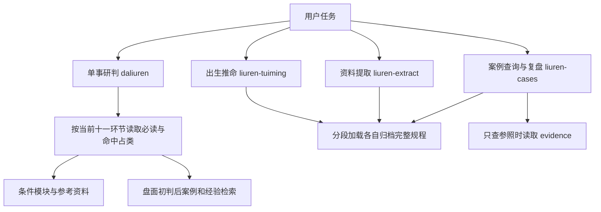

# 当前调用清单（首轮）

活动版本：`20261105-liqi-led-02`。4个技能入口、59个内部模块。

清点、文件存在、声明依赖和链接检查不等于语义精读；下表明确保留未完成状态。

以上表示目前入口关系，不是建议的新专业流程。AGENTS、本机模式提示和报告规则也是待协调指令源。

## 技能入口

- `daliuren`：[.opencode/skills/liuren/daliuren/SKILL.md](../../.opencode/skills/liuren/daliuren/SKILL.md)；入口全文已核；不代表全部下游完成。
- `liuren-cases`：[.opencode/skills/liuren/liuren-cases/SKILL.md](../../.opencode/skills/liuren/liuren-cases/SKILL.md)；入口全文已核；不代表全部下游完成。
  加载器：`tools/load-liuren-procedure.py`；旧完整规程存在：True；仅核加载关系；未完成旧规程逐条审查。
- `liuren-extract`：[.opencode/skills/liuren/liuren-extract/SKILL.md](../../.opencode/skills/liuren/liuren-extract/SKILL.md)；入口全文已核；不代表全部下游完成。
  加载器：`tools/load-liuren-procedure.py`；旧完整规程存在：True；仅核加载关系；未完成旧规程逐条审查。
- `liuren-tuiming`：[.opencode/skills/liuren/liuren-tuiming/SKILL.md](../../.opencode/skills/liuren/liuren-tuiming/SKILL.md)；入口全文已核；不代表全部下游完成。
  加载器：`tools/load-liuren-procedure.py`；旧完整规程存在：True；仅核加载关系；未完成旧规程逐条审查。

## 59个模块

| ID | 角色 | 当前必读环节/触发 | 声明依赖 | 审查状态 |
|---|---|---|---|---|
| [risk](../../runtime/liuren/20261105-liqi-led-02/details/risk.md) | 条件方法/参考/维护 | 四大凶象承担主判或最强反证 | — | 仅完成清点；本轮未登记语义审查完成 |
| [shensha-tradition](../../runtime/liuren/20261105-liqi-led-02/details/shensha-tradition.md) | 条件方法/参考/维护 | 采用季煞或传统神煞层级说明 | — | 仅完成清点；本轮未登记语义审查完成 |
| [classical-conflict](../../runtime/liuren/20261105-liqi-led-02/domains/classical-conflict.md) | 占类专项 | 占类命中 | — | 仅完成清点；本轮未登记语义审查完成 |
| [exam](../../runtime/liuren/20261105-liqi-led-02/domains/exam.md) | 占类专项 | 占类命中 | — | 仅完成清点；本轮未登记语义审查完成 |
| [finance](../../runtime/liuren/20261105-liqi-led-02/domains/finance.md) | 占类专项 | 占类命中 | — | 仅完成清点；本轮未登记语义审查完成 |
| [illness](../../runtime/liuren/20261105-liqi-led-02/domains/illness.md) | 占类专项 | 占类命中 | — | 仅完成清点；本轮未登记语义审查完成 |
| [interpersonal](../../runtime/liuren/20261105-liqi-led-02/domains/interpersonal.md) | 占类专项 | 占类命中 | — | 仅完成清点；本轮未登记语义审查完成 |
| [long-period](../../runtime/liuren/20261105-liqi-led-02/domains/long-period.md) | 占类专项 | 占类命中 | — | 重点正文或相关段核读；未完成逐条溯源审查 |
| [lost-person-object](../../runtime/liuren/20261105-liqi-led-02/domains/lost-person-object.md) | 占类专项 | 占类命中 | — | 仅完成清点；本轮未登记语义审查完成 |
| [period-outlook](../../runtime/liuren/20261105-liqi-led-02/domains/period-outlook.md) | 占类专项 | 占类命中 | — | 重点正文或相关段核读；未完成逐条溯源审查 |
| [pregnancy](../../runtime/liuren/20261105-liqi-led-02/domains/pregnancy.md) | 占类专项 | 占类命中 | — | 仅完成清点；本轮未登记语义审查完成 |
| [promotion-salary](../../runtime/liuren/20261105-liqi-led-02/domains/promotion-salary.md) | 占类专项 | 占类命中 | — | 仅完成清点；本轮未登记语义审查完成 |
| [recruitment](../../runtime/liuren/20261105-liqi-led-02/domains/recruitment.md) | 占类专项 | 占类命中 | — | 仅完成清点；本轮未登记语义审查完成 |
| [relationship](../../runtime/liuren/20261105-liqi-led-02/domains/relationship.md) | 占类专项 | 占类命中 | — | 仅完成清点；本轮未登记语义审查完成 |
| [adjudication](../../runtime/liuren/20261105-liqi-led-02/methods/adjudication.md) | 共同必读 | 8 | liqi | 重点正文或相关段核读；未完成逐条溯源审查 |
| [evidence](../../runtime/liuren/20261105-liqi-led-02/methods/evidence.md) | 共同必读 | 10 | — | 重点正文或相关段核读；未完成逐条溯源审查 |
| [liqi](../../runtime/liuren/20261105-liqi-led-02/methods/liqi.md) | 共同必读 | 3 | — | 重点正文或相关段核读；未完成逐条溯源审查 |
| [movement](../../runtime/liuren/20261105-liqi-led-02/methods/movement.md) | 共同必读 | 6 | — | 仅完成清点；本轮未登记语义审查完成 |
| [positioning](../../runtime/liuren/20261105-liqi-led-02/methods/positioning.md) | 共同必读 | 2 | — | 重点正文或相关段核读；未完成逐条溯源审查 |
| [relations](../../runtime/liuren/20261105-liqi-led-02/methods/relations.md) | 共同必读 | 3 | — | 重点正文或相关段核读；未完成逐条溯源审查 |
| [report](../../runtime/liuren/20261105-liqi-led-02/methods/report.md) | 共同必读 | 11 | liqi | 重点正文或相关段核读；未完成逐条溯源审查 |
| [structure](../../runtime/liuren/20261105-liqi-led-02/methods/structure.md) | 共同必读 | 3 | — | 重点正文或相关段核读；未完成逐条溯源审查 |
| [timing](../../runtime/liuren/20261105-liqi-led-02/methods/timing.md) | 条件方法/参考/维护 | 有时间任务 | — | 仅完成清点；本轮未登记语义审查完成 |
| [void](../../runtime/liuren/20261105-liqi-led-02/methods/void.md) | 共同必读 | 3 | — | 重点正文或相关段核读；未完成逐条溯源审查 |
| [bashajiubao](../../runtime/liuren/20261105-liqi-led-02/references/bashajiubao.md) | 共同必读 | 5 | — | 仅完成清点；本轮未登记语义审查完成 |
| [beihai-extend-sop](../../runtime/liuren/20261105-liqi-led-02/references/beihai-extend-sop.md) | 条件方法/参考/维护 | per-entry route; read full applicable conditions | — | 仅完成清点；本轮未登记语义审查完成 |
| [bifa](../../runtime/liuren/20261105-liqi-led-02/references/bifa.md) | 条件方法/参考/维护 | per-entry route; read full applicable conditions | — | 仅完成清点；本轮未登记语义审查完成 |
| [blade-methods](../../runtime/liuren/20261105-liqi-led-02/references/blade-methods.md) | 条件方法/参考/维护 | per-entry route; read full applicable conditions | — | 仅完成清点；本轮未登记语义审查完成 |
| [case-retrieval-v2](../../runtime/liuren/20261105-liqi-led-02/references/case-retrieval-v2.md) | 条件方法/参考/维护 | per-entry route; read full applicable conditions | — | 仅完成清点；本轮未登记语义审查完成 |
| [daliuren-paipan](../../runtime/liuren/20261105-liqi-led-02/references/daliuren-paipan.md) | 条件方法/参考/维护 | 需要起课或核对程序盘 | — | 仅完成清点；本轮未登记语义审查完成 |
| [daliuren-shensha](../../runtime/liuren/20261105-liqi-led-02/references/daliuren-shensha.md) | 条件方法/参考/维护 | per-entry route; read full applicable conditions | — | 仅完成清点；本轮未登记语义审查完成 |
| [engine-shensha-output](../../runtime/liuren/20261105-liqi-led-02/references/engine-shensha-output.md) | 共同必读 | 5 | — | 仅完成清点；本轮未登记语义审查完成 |
| [experience-retrieval-v2](../../runtime/liuren/20261105-liqi-led-02/references/experience-retrieval-v2.md) | 条件方法/参考/维护 | per-entry route; read full applicable conditions | — | 仅完成清点；本轮未登记语义审查完成 |
| [keti-quanbiao](../../runtime/liuren/20261105-liqi-led-02/references/keti-quanbiao.md) | 条件方法/参考/维护 | per-entry route; read full applicable conditions | — | 仅完成清点；本轮未登记语义审查完成 |
| [kundun](../../runtime/liuren/20261105-liqi-led-02/references/kundun.md) | 条件方法/参考/维护 | per-entry route; read full applicable conditions | — | 仅完成清点；本轮未登记语义审查完成 |
| [liqi-examples](../../runtime/liuren/20261105-liqi-led-02/references/liqi-examples.md) | 条件方法/参考/维护 | per-entry route; read full applicable conditions | — | 仅完成清点；本轮未登记语义审查完成 |
| [liqi-sources](../../runtime/liuren/20261105-liqi-led-02/references/liqi-sources.md) | 条件方法/参考/维护 | 所采用方法存在来源或口径分歧 | — | 仅完成清点；本轮未登记语义审查完成 |
| [nianming](../../runtime/liuren/20261105-liqi-led-02/references/nianming.md) | 条件方法/参考/维护 | 涉及本命或行年规则的计算、核验或采用 | — | 仅完成清点；本轮未登记语义审查完成 |
| [rule-semantics](../../runtime/liuren/20261105-liqi-led-02/references/rule-semantics.md) | 条件方法/参考/维护 | 否定范围、摘要条件或规则强度存疑 | — | 仅完成清点；本轮未登记语义审查完成 |
| [shensha-engine-index](../../runtime/liuren/20261105-liqi-led-02/references/shensha-engine-index.md) | 条件方法/参考/维护 | per-entry route; read full applicable conditions | — | 仅完成清点；本轮未登记语义审查完成 |
| [shensha-field-meanings](../../runtime/liuren/20261105-liqi-led-02/references/shensha-field-meanings.md) | 条件方法/参考/维护 | per-entry route; read full applicable conditions | — | 仅完成清点；本轮未登记语义审查完成 |
| [shensha-focus](../../runtime/liuren/20261105-liqi-led-02/references/shensha-focus.md) | 共同必读 | 5 | bashajiubao, engine-shensha-output | 仅完成清点；本轮未登记语义审查完成 |
| [shensha-meaning-sources](../../runtime/liuren/20261105-liqi-led-02/references/shensha-meaning-sources.md) | 条件方法/参考/维护 | per-entry route; read full applicable conditions | — | 仅完成清点；本轮未登记语义审查完成 |
| [shensha-meanings](../../runtime/liuren/20261105-liqi-led-02/references/shensha-meanings.md) | 条件方法/参考/维护 | per-entry route; read full applicable conditions | — | 仅完成清点；本轮未登记语义审查完成 |
| [shensha-other-meanings](../../runtime/liuren/20261105-liqi-led-02/references/shensha-other-meanings.md) | 条件方法/参考/维护 | per-entry route; read full applicable conditions | — | 仅完成清点；本轮未登记语义审查完成 |
| [shensha-sources](../../runtime/liuren/20261105-liqi-led-02/references/shensha-sources.md) | 条件方法/参考/维护 | per-entry route; read full applicable conditions | — | 仅完成清点；本轮未登记语义审查完成 |
| [shensha-use](../../runtime/liuren/20261105-liqi-led-02/references/shensha-use.md) | 共同必读 | 5 | bashajiubao, shensha-focus | 仅完成清点；本轮未登记语义审查完成 |
| [quantity](../../runtime/liuren/20261105-liqi-led-02/methods/quantity.md) | 条件方法/参考/维护 | 原问要求金额、分数、数量、重量、距离等数值，或已选应期专法需要数理时长 | — | 仅完成清点；本轮未登记语义审查完成 |
| [quantity-sources](../../runtime/liuren/20261105-liqi-led-02/references/quantity-sources.md) | 条件方法/参考/维护 | 需要核对取数数表、原法条件或精确数值案例；已取得对应原书可复用 | quantity | 仅完成清点；本轮未登记语义审查完成 |
| [workflow-contract](../../runtime/liuren/20261105-liqi-led-02/methods/workflow-contract.md) | 条件方法/参考/维护 | explicit structured audit only | — | 仅完成清点；本轮未登记语义审查完成 |
| [class-mapping](../../runtime/liuren/20261105-liqi-led-02/methods/class-mapping.md) | 共同必读 | 2 | — | 仅完成清点；本轮未登记语义审查完成 |
| [shenjiang-use](../../runtime/liuren/20261105-liqi-led-02/methods/shenjiang-use.md) | 条件方法/参考/维护 | 采用神将同用、互换，或需要核对具体神将类义的适用范围 | liqi | 仅完成清点；本轮未登记语义审查完成 |
| [shen-symbols](../../runtime/liuren/20261105-liqi-led-02/references/shen-symbols.md) | 条件方法/参考/维护 | 需查十二天神的基础义、复合取义或与本家天将的差别 | shenjiang-use | 仅完成清点；本轮未登记语义审查完成 |
| [jiang-symbols](../../runtime/liuren/20261105-liqi-led-02/references/jiang-symbols.md) | 条件方法/参考/维护 | 需查十二天将的职能、占类取义或与本家支神的差别 | shenjiang-use | 仅完成清点；本轮未登记语义审查完成 |
| [home](../../runtime/liuren/20261105-liqi-led-02/domains/home.md) | 占类专项 | 占类命中 | — | 仅完成清点；本轮未登记语义审查完成 |
| [travel](../../runtime/liuren/20261105-liqi-led-02/domains/travel.md) | 占类专项 | 占类命中 | — | 仅完成清点；本轮未登记语义审查完成 |
| [weather](../../runtime/liuren/20261105-liqi-led-02/domains/weather.md) | 占类专项 | 占类命中 | — | 仅完成清点；本轮未登记语义审查完成 |
| [agriculture](../../runtime/liuren/20261105-liqi-led-02/domains/agriculture.md) | 占类专项 | 占类命中 | — | 仅完成清点；本轮未登记语义审查完成 |
| [mapping-provenance](../../runtime/liuren/20261105-liqi-led-02/references/mapping-provenance.md) | 条件方法/参考/维护 | 需核合并对应、旧 I/B 上下文、原卡或未决条件 | — | 仅完成清点；本轮未登记语义审查完成 |

## 静态检查范围

共同必读 14 项，占类 16 项；未知声明依赖 0 项，声明依赖环 0 项。
检查代码围栏外相对Markdown链接出现次数 356，未找到目标的出现次数 0。仅是文件目标存在检查，不判断规则或引用内容是否正确。

另见：shensha-field-meanings.md的源码展示含路径样式插入，需回源核对展示保真；不能计为流程跳转失败，也不能据此推断排盘引擎发生改变。

完整路径、哈希、依赖、链接记录及路由快照见 [module-map.json](module-map.json)。
