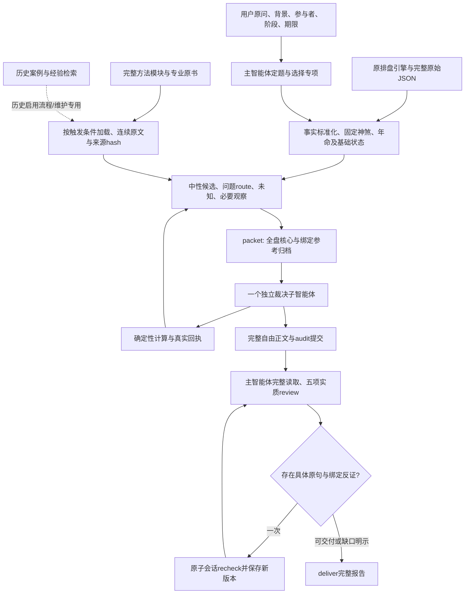

# 大六壬AI完整架构与工作流程说明

导出日期：2026-11-16。本文件合并完整版导航、总体架构、记忆取用、引擎及工具接口，供独立阅读。

# 最新完整版资产的直接阅读入口

请把本页作为独立AI阅读专业完整设计的起点，避免误入62版短答入口。

`full-design/` 把已经存在的完整资产逐字节复制到一起，来源与hash在 `audit/full-design-reading-map.json`。这是一组阅读副本，不是新建、已经联调验收的发布版本；完整原路径仍在 `project/`。

1. `full-design/Codex入口-SKILL.md`：当前Codex完整占断指令。
2. `full-design/OpenCode完整入口-55原文.md`：最近完整OpenCode调用入口；对应的完整Prompt/权限恢复层在profiles/full55-overlay。
3. `full-design/最新保留完整专业核心-62.md`：最新冻结包仍保留的完整judgment-core，**不是class-selection-trial短方法**。它包含55之后的U02喜旺恶衰解释与旺衰标签修订，不能因这些修订发生在试验期间便删掉。
4. `full-design/专项/`：最新冻结包的17份完整专项；这些与55对应完整专项字节相同，独立于trial-domain摘录。
5. `full-design/完整裁决规则.md`、`最新保留裁决者Prompt.md`、`完整报告规则.md`：完整独立裁决与报告要求。
6. 其他详细方法、应期数量、神煞、毕法、来源证据和争点，按 `project/runtime/liuren/20261115-class-selection-62/manifest.json` 与模块索引定位全文。
7. 完整记忆检索实现与历史启用入口，见记忆取用说明、早期冻结包、tools检索器和原书/案例/经验/研究资料。

两件事需要同时保留：**55是可恢复且本次通过绑定与传输测试的完整执行基线；62仍保存更新过的完整专业核心，但其OpenCode默认执行路线是短答。** 本包同时导出两者，没有把55称作所有专业内容的最后修改版，也没有把62的短答Prompt当作完整版。

`audit/完整核心55至62差异.diff` 显示最新完整核心相对55的逐行变化。把更新核心接入完整裁决宿主时，需核对加载合同、Prompt、权限和实现绑定；本次没有未经验证地改写指针或生成一个“已运行最新版合体包”。


---

# 架构与完整工作流程

## 1. 架构的实际边界

系统是“专业规则与资料 + 确定性排盘/计算 + 宿主工具接口 + 主智能体中性准备 + 独立子智能体裁决 + 证据核对与完整交付”的组合。它不是一个单独 API，也不是把整库一次性塞入 Prompt 的单体脚本。Python 管理资料与检索；Node.js 运行原排盘、派生事实、计算、交接合同与状态机；OpenCode/Codex 宿主负责真实模型会话。

程序只核事实、查表、算数和数据约束。选取用神/类神、解释其在原问中的职责、判断有效制救与最终成败属于专业裁决。相关工具不会通过最高分自动选类，也不会把旺衰分解释成成功概率。



图中最后一条虚线是被保留的检索能力；55 与 62 的普通占断均禁止两库检索。62 在进入独立裁决前已经走另一条短答路线，不能用这张图声称 62 正在完整执行。

## 2. 两个宿主入口

| 入口 | 配置及指令 | 职责与真正的调用链 |
|---|---|---|
| Codex | `integrations/codex/daliuren-codex/SKILL.md`、`references/host.md`、项目 `AGENTS.md`、`docs/Codex大六壬工作流.md` | 用户说“使用大六壬进行测算”时启用；主准备，`tools/liuren-codex.mjs` 桥接原生子智能体及共享合同；原生 `collaboration.spawn_agent` 显式 `gpt-6.1-sol/high/fork_turns=none` |
| OpenCode | `opencode.json`、`.opencode/skills/liuren/*`、`.opencode/oh-my-opencode-slim.jsonc`、`.opencode/plugins/liuren-adjudication.ts`、`.opencode/tools/*.ts` | 注册受限资料/排盘/计算/交接工具；主用 `task` 派 `liuren-adjudicator`，固定 DeepSeek Flash/high；slim 插件管理子会话与结果传递 |

二者共用活动指针、规则、排盘、计算和核心交接实现，不互相嵌套。Codex 不调用 OpenCode 的 task，不套用 DeepSeek 的 393216 输出额度；OpenCode 不使用 Codex 的原生子智能体 ID。Codex 桥接通过 `bind` 记录真实原生 ID，但共享文件回执不能构成操作系统级隔离或独立认证。

OpenCode 完整配置中的主模型与裁决模型分别设置：主入口为 `conpera/gpt-6.1-sol`、high，裁决为 `deepseek/deepseek-flash`、high，完整裁决配置显式预算 393216。它们是本地配置值；本次没有验证供应商模型可用性或最大额度兑现。用户级配置的脱敏快照在 `external/`，不收集认证存储。

当前 62 的主 Prompt 明令短答，不读完整裁决三模块，不创建 packet/task，不做 review。恢复完整流程必须使用一套完整匹配的入口、权限、实现与指针；不能只把短 Prompt 换成一篇长文字。

## 3. 活动指针、冻结版本和动态加载

`.opencode/liuren-active.json` 指定 release、runtime、methodVersion、Skill 哈希、实现源码哈希、原书检索索引、采用神煞规则及实验开关。`load-liuren-methods.py` 的 `active/content/plan_steps` 读取指针与 `manifest.json`，校验正文身份，并处理精确登记的本机排盘操作覆盖项。运行中不是随意搜索整个 runtime 找最新版。

每个冻结 runtime 保存 `entry.md`、`manifest.json`、`reading-route.json`、`source-read-map.json`、`loader-contract.json`、methods/domains/references/details/procedures，以及迁移/整合/覆盖证据。`manifest.files` 是正文白名单与哈希；`modules` 是模块 ID 到文件、依赖和触发条件的映射；alias 是旧 ID 兼容，不是重复裁决轮次。

`source-read-map.json` 将历史引文绑定到精确原件和 hash；不是开放旧包全目录扫描。`loader-contract.json` 和指针中的实现 hash 可发现磁盘源码与已加载约定不一致；宿主进程重载还需新进程的真实 workflow ready 回执。磁盘校验不能证明一个已经运行的 OpenCode 进程热加载成功。

本包保留所有可读取的 `runtime/liuren/` 冻结版本，包括其中历史保留副本。旧包里偶有八字/出生推命等历史资产，只供溯源；不进入最新普通占断的活动计划。

最新保留的完整核心在62包中仍有55之后的修订：U02喜旺恶衰的数值执行解释与旺衰标签边界。17份完整专项以及adjudication/report与55对应原文字节相同；完整核心则不同。`full-design/`和逐行diff保留这一区别。下节用55解释可复现的完整执行链，不以此撤销后续已存在的专业资产。

## 4. 完整专业执行顺序（以 55 为完整基线）

### 4.1 检查与问题理解

Codex 跑 `node tools/liuren-codex.mjs status`；OpenCode 跑 `python -X utf8 tools/liuren-preflight.py` 并在新会话调用 `liuren_tool_help(topic=workflow,domains=[本问])`。保存用户原问，逐问区分事件、对象、阶段、截止期、成功标准与结果形式。原问明确、主推断、未知和盘推必须分别标识。

按实际事件选择 17 专项中的分支。招聘、升职、财务或关系等不能仅按一个关键词路由，更不能把“是否录用”改成“待遇好坏”，或把“经营概况”改成“何时回款”。路线写进 `input_review.questions[].route`：event、focus、primary_entity_ids、selection_basis、time_scope。

### 4.2 阅读专业规则并取得可信盘

准备阶段读取 `judgment-core`、`adjudication` 与本问 domain；交付前读 `report`。详细 positioning/liqi/void/structure/shensha-use/movement 及原书只在条件不足、适用分歧或反证缺口时触发。原规则全文都在包中，“按需读取”不是删除规则。

可信盘由原引擎生成并归档，传递原始 hash。原始 JSON 的自动断语与程序事实分开。完整十二宫、四课四槽、三传三槽、全宫神煞及来源身份不能被摘要替代。同输入且已核验的盘可复用，同卦续问只补新争点。

### 4.3 取用与盘面提取

主智能体按专项职责首取/有条件递补，记录来源和条件，不因旺弱、空亡或偏好结论改换更好看的类神。人物天盘类神与地盘本命/行年上的上神分开。关系题保留必要双方及关系，整体题可没有唯一单类。

`entities` 保存候选坐标和现实指代；`observations` 仅保留必要方法观察；`facts` 只补现实事实，不能手填“确定性事实”冒充程序输出。`focus_issues` 是真实未决问题，不能夹带主智能体完整判词。程序核对 ID、坐标与题目覆盖，不替代专业取用。

### 4.4 旺衰、整体气势与有效关系

先观察课势以确定本问侧重，再沿主类实际坐标察月令、地气、十二状态、空墓、乘将、课传与相互作用。理气贯穿；不是每套理论轮流给一票。区分施者状态、受者状态、通路、对象、作用环节、先后与能否兑现。

`strength/local-strength/palace-strength` 等程序计算已选对象及关系。单宫分不能代表完整关系链，月令值不能代替坐处十二气，数值较高不能自动消除闭口等专项条件。跨宫数值增减要用真实关系补算回执，不自动全盘联算。全部算法、参数 profile、实验性说明均保留。

### 4.5 吉凶综合、制救与冲突处理

支持与最强反证使用相同证据标准，明确哪一条件有效、救谁制谁、解除哪一障碍及作用多少。自身旺、吉名与现实结果已兑现分别判断；真实结论由所问事件与关键作用链形成。多个术语指向同一事实不能重复数票。课体、毕法和神煞作为有界辅助，不另开独立裁决轮次。

U01—U11 是已确认政策，历史 C 编号不是待确认列表；V41-01 依当前保留决定处理。具体内容见绑定 `judgment-core` 和 `confirmedJudgmentPolicy`，不能只根据本说明缩写重新实现规则。

### 4.6 年命、应期和数量

用户明确出生年、本命或行年时采用 `year_life/life`，无生日不弃用；缺性别只影响行年候选。出生推命与出生运限退出普通流程，长期占事和正常应期仍保留。

应期按原问实际形成/评定/公布/兑现节点，用 calendar/evaluation 验证候选；不按最高分自动择期。数量按 quantity、quantity-strength、quantity-correction 分 source/experimental 路径；先核原法适用性，再求基础数、旺衰与空的使用、量级、单位和例外，最后 `quantity_adjustment` 消费同 run 真实回执。非零进位、免空减等例外须有连续原文及本问应用说明；不能重复扣空或将名次机械折半。

### 4.7 中性交接和独立裁决

packet 校验原问逐字引句、问题/对象/route 与中性来源身份；从可信归档生成完整核心并绑定方法、原书段和计算材料。`core-with-bound-reference-archive` 保留完整盘核心，参考用 ID/hash 按需回读，避免派工消息装入巨量 JSON 而截断。

一个新任务只派一个独立裁决者。子智能体读完整核心，从全盘查漏，候选可以依据事实和规则纠正。OpenCode 的完整角色 Prompt 原文在 `.opencode/oh-my-opencode-slim.jsonc` 的 `agents.liuren-adjudicator.prompt`；Codex `role` 绑定专业角色并提供 host_mapping。完整配置与可读 Prompt 提取件都在包中。

裁决者逐问给直接结论、决定性依据、最强反证与取舍理由，完整自由正文加 audit 提交，成功后只回小回执。正文持久化，不用内部推理替代最终报告。读取回执证明工具输出，不证明语义理解。

### 4.8 五项核对、一次补核与忠实交付

主领取并读完整报告，五项 review 检查：原问事件/事实、首取在实判中的职责阶段、数法/量级及计算范围、有效反证/制救、逐问约束。evidence_refs 必须来自本任务已绑定 ID/回执；职责项覆盖每个 `route:问ID`。

具体报告原句与绑定证据支持真实问题时，原子会话 recheck 一次，保存 report 与 report-recheck。补核不预先锁结论或数字，不另派，不由主折中改判；剩余缺口登记并完整交付。格式错误只修格式。长度停止且无已保存正文时，按 next_call 原会话 recover 一次，仍无正文明确未完成。

`deliver` 绑定实际报告 hash 与 review，主忠实复述结论、数值、精度和条件。它是交付门禁，不是专业正确性证明。

## 5. Skill、依赖与按需组合

| Skill/机制 | 触发与职责 | 与其他部分的关系 |
|---|---|---|
| daliuren-codex | 明确占断及同卦续问 | Codex 总入口；调用完整方法、盘、计算、packet/原生子/review/deliver |
| daliuren | OpenCode 普通占事 | 完整版为主专业入口；62 同名入口被短答试验覆盖，须按版本区分 |
| liuren-cases | 案例查询、反馈、知识维护 | 独立维护入口；普通无两库占断不能借此绕取案例 |
| liuren-extract | 从原书/资料提取带条件的方法 | 调用 workbench、来源核对、规则/审查附加层；不自动启动预测裁决 |
| 历史分项 Skill/refs | 旧完整体系的细分方法 | 全文及迁移映射在冻结 runtime/来源快照中；新模块可能 alias/合并，不能同时叠加所有历史要求 |
| 原装 slim Skill/能力 | 宿主侧 task、task_result 与会话生命周期 | 固定插件发行代码附在 vendor；与本项目专业判断规则不是同一层 |

完整逐模块的文件、requires、required、trigger/when、别名与各版差异在 `audit/runtime-module-catalog.json` 及 Markdown 索引。它补足上表，不用简短表格替代原 Skill。课程写作、统筹、绘图和网站运营等未参与普通占断的 Skill 不作为必需依赖打包；被精确引用的毕法整理本则由引用闭包收入。

## 6. 状态矩阵与组合限制

| 能力 | 55 完整裁决基线 | 当前 62 OpenCode | 代码/设计保留情况 |
|---|---|---|---|
| 完整专业核心与17专项 | 执行 | 专项摘录参与短答；完整核心不走默认路线 | 各冻结包全文保留 |
| 独立子裁决、audit、review/deliver | 执行 | 默认禁止 | 共用实现与角色配置保留，Codex完整路线保留 |
| 原书精确检索 | 按需 | 条件不足时定点查询 | 七书索引及更广全文检索均保留 |
| 案例/经验检索 | 普通占断禁用 | 普通占断禁用 | 早期完整流程和维护工具保留 |
| 数量/分数/名次/应期 | 按问触发 | 暂停 | 完整算法、原法登记与例外保留 |
| 62 喜旺恶衰/五行月令试验解释 | 非55既有规则 | 执行 | 是试验语义，不反向合并为55已验规则 |
| 客户历史报告/真实任务缓存 | 任务原位保存 | 不进入普通材料范围 | 本包排除，用合成样例说明结构 |
| 外部模型/宿主安全隔离 | 需真实宿主运行 | 需真实宿主运行 | 不含平台源码、凭据或OS级隔离实现 |

历史发布记录称通过的工程测试仅作为历史证据；本次在导出副本中重做的验证另见报告。现有工作流没有提供已证实预测准确率。

## 7. 为什么这些机制必须一起看

只有规则而没有加载器，会丢失触发条件与版本身份；只有盘面而没有完整原 JSON，会丢失数据来源与错误定位；只有子 Prompt 而没有 packet/绑定/read/submit，会丢失真正的独立会话交接；只有历史文件而没有检索/排除/回读/注入协议，会误解记忆如何生效；只有报告正文而没有回执和 review，会无法区分已提交、被核对和仅有模型完成声明。

审计时应沿“原问 → 可信数据 → 本版规则 → 中性候选 → 已绑定证据 → 独立裁决 → 已保存报告 → 五项review → 原会话补核 → deliver”逐层核验。恢复历史两库检索时，还要将来源去重、已知同案排除、状态筛选与参考绑定接入；只把缓存文件复制进目录并不使检索自动启用。


---

# 记忆取用与知识检索机制

## 1. 这里有四类不同的“记忆”

| 类型 | 实际存储 | 如何进入模型上下文 | 状态 |
|---|---|---|---|
| 专业来源与经验记忆 | 案例项目库、经验日志、研究规则/审查卡及原书 | 检索返回定位/片段，必要时分页读原文，采用时保留来源条件与反证 | 两库在早期完整流程/维护中可用；55和62普通占断禁用 |
| 同一次任务的工作状态 | session/packet/core/references/计算回执/report/review/flow状态 | 当前 run 的 reader/result/compute 与 next_call/next_request | 完整裁决实际实现；短答入口不执行完整交接 |
| 同卦续问的已读材料 | 宿主当前会话、可靠盘归档、同版真实已读资料 | 复用原盘与前情，只补受影响争点和依赖 | 有规则与持久化材料，不能据“文件存在”证明模型记住 |
| Codex/OpenCode 平台会话或跨会话记忆 | 宿主自己的会话存储、平台注入、用户全局记忆 | 宿主在会话开始注入或受控检索；不是本项目 Python 检索器自动读取 | 本项目不拥有平台完整实现；不导出全局聊天数据库或个人记忆 |

没有发现本机专业检索链中实现 embedding 向量库、向量召回或自动将所有历史对话训练进模型的机制。现有专业检索是可追溯的文件/结构化索引/关键词或字段相关性排序。不能给它补写一套未存在的“向量长期记忆”。

## 2. 专业记忆的完整存储结构

`案例项目库/` 保存按占类组织的规范案例，META、原题、盘面、原断、旧解释与反馈身份供 `case_retrieval.py` 解析。主 README 的历史数量已经过期，本包文件清单才是导出时实际资产数；文件数也不等于独立事件数。

`经验日志/` 保存原书蒸馏、待验证经验和反馈复盘。`docs/经验库梳理/20261019/data/catalog.json` 是旧审读条目标注底座；工具每次核对其原文位置，原文变化则不能继续把旧标注当有效结论。

`knowledge/liuren-research/20261102/rules/*.json` 是带条件规则卡；`audits/*.json` 是旧条目审查；`families/*.json` 表达同源、分支、依赖或冲突；`method-reviews/` 与 `workflow/` 保留更大范围来源审读、映射和方法调整。`book-cases/` 保存书内例证身份与重建材料。审查卡是附加层，不覆盖旧来源原字节。

规则卡的关键字段是 conditions、exclusions、conclusion、reasoning_steps、alternatives、evidence_refs、source/support/counterexample 身份、status、review_state 与 independent_validation_count。source_method 表示书中有此法，source_checked 表示来源查过，均不表示预测已经被独立验证。

原书在 `书籍库/` 与 `books/`；引擎内置原文也有导出来源。`资料来源/qq-homework-20261018/` 是已登记的历史专业资料副本；测试私有答案目录从本包排除，不能把“有本地副本”理解成任何题目都允许查答案。新增专业归纳须保留来源、版本、条件、反证及缺口。

## 3. 案例检索：实际召回与排序

入口 `tools/search-cases.py` 调用 `case_retrieval.ensure_index/retrieve/render`。缓存默认 `output/case-index-v2/index.json`，由源码、原文和研究附加层指纹决定是否重建。本包提供原文和重建代码，不需要携带旧运行缓存。

工具先解析原文为案例及子问单位，正规化同义字词，如返吟/反吟、螣蛇/腾蛇，并使用中文连续字串的双字片段、数字和英文词。查询可以带占类、课体、发用、三传、日干、类神等字段。

排序把问题相关性、背景相关性与盘面六维分分开。当前源码六维权重包含占类25、课体20、发用15、类神15、三传15、日干10；问题目标、词面重叠、方法命中又独立进入总相关性。它们是召回设计参数，不是古籍原文、正确率或置信度。反馈没有作为“预测正确”的乘数。

`known_exclusions` 与来源身份映射排除同案、保留组或已暴露来源。`exclude-source` 是明确控制项。相同事件跨库、同案多人作答、跨书转引均不能算多个独立证据。未知同源仍可能漏识别，是需要审计的真实限制。

调用例：

```powershell
python -X utf8 tools/search-cases.py --query "轮岗 职务" --category 事业占 --limit 3 --json
```

输出包含问题单位、案例来源、相关性分及分项、命中词、检索覆盖和同源排除；`render` 只渲染定位/材料，不自动生成预测结论。

## 4. 经验检索：鲜度、条件与审查附加层

入口 `tools/search-experience.py` → `experience_retrieval.ensure_index/retrieve/render`。工具从经验原档切出有限段，核对 catalog 的 source_excerpt/line_start/line_end，并以源文件 hash、catalog hash 和版本形成 fingerprint。新改段落作为未审片段，不能自动升格为已验证规则。

`liuren_research_overlay.py` 在载入时调用工作台 `validated_records`，核对证据连续引文、行号、hash 及依赖，再给旧案例或经验附加 retain/narrow/revise/suspend/pending 审查、替代卡与明确作用范围。原书的不同案例用“书路径+行段”区分，避免整本书都被当同一个事件。

经验排序以标题命中、标签命中、正文命中和占类偏好计算相关性，并做同源归并。默认暂停项不进入采用候选；`--include-suspended` 仅用于显式审查，不能允许预测采用暂停结论。排名仍不裁专业真假。

```powershell
python -X utf8 tools/search-experience.py --query "巳上辰 破墓" --limit 5 --json
python -X utf8 tools/liuren_knowledge_workbench.py status
python -X utf8 tools/liuren_knowledge_workbench.py validate
```

workbench 的 build/status/next/search/validate 负责资产、覆盖、待办与引文核查。切段或 hash 相同只能证明机械身份，不证明语义通读。

## 5. 检索何时触发、怎样进入上下文

### A. 历史整合完整流程

`tools/liuren-workflow.py` 是 CLI，实现在 `liuren_workflow.py`。`prepare` 固定原问、子问任务、可信盘、活动方法计划、exclude_sources 和 source_id；构造“子问 + 课体 + 查询词”，推导偏好占类，调用案例和经验检索器，汇总候选与来源回执。

它写出：

| 文件 | 作用 |
|---|---|
| session.json | 固定输入、事实 hash、引擎/工作流源码 hash、规则版本、全部合格候选和来源身份 |
| coverage.json | 完整候选 ID、已返回/省略项；排序靠后不能被说成不存在 |
| context.json | 送入 AI 的原问、可信盘、子问、版本、模块计划与覆盖定位 |
| evidence-packet.json | 案例/经验短名单及来源、条件、审查与覆盖信息；这是实际上下文材料 |
| reads.json | 每个模块/候选/原文部分的分页输出回执 |

AI 必须实际读取 context 与 evidence-packet，按 `read --id module:ID` 或候选 ID 回读原文。候选可读 record/source/evidence:N/source_case:N；连续文本按页给出，并记录 tool_output_only。每次 read 核当前源文件、规则资格和原 session 绑定；源码/活动版本/来源改变时拒绝沿用旧身份。

`check` 核对采用记录：哪些证据已读、适用条件、差异、反证、暂停资格、盘面事实和问题覆盖。没有合格采用记录不能凭检索命中说“经验支持”。check 通过仍不证明术理判断正确。

### B. 按需直接阅读完整流程

20261103 的直接读取路线取消“每次必须 prepare”的硬门槛，保留通过短查询检索两库、实际回读原档、说明相似/差异与未读范围。完整入口和历史 Prompt 在冻结包与发布 before 中，不被当前短答入口替换。

### C. 当前禁用点

`liuren_retrieval_policy.case_experience_disabled` 读取活动指针 `experiment.disableCaseExperience`。`liuren-materials.py` 的 retrieve 和 `MaterialScope` 的 cases/experience 扫描/读取检查该开关；缓存回读也受限。OpenCode permission/Prompt 另有限制，独立子 reader 只开放本任务绑定参考。`search-cases.py` 和 `search-experience.py` 本身是维护 CLI，不是操作系统隔离；不能据普通代理权限限制声称源码命令永远不可运行。

55 完整裁决版本已经禁用两库，62 延续禁用且缩成主直接短答。关闭检索不等于删除已学习的方法或书内例证。旧经验库文档中仍写“当前普通研判查询两库”的文字是历史残留，不能覆盖活动开关。

恢复更早检索能力，至少要同时处理：活动指针、资料工具策略、宿主 permission/Prompt、候选来源排除、分页读取、引用绑定及审查状态。仅修改一个布尔值不足以证明完整接通。本包没有擅自启用这个组合。

## 6. 原书检索与专业记忆的关系

`liuren_book_search.py` 使用 `knowledge/liuren-book-index/{20261105,20261112}/` 的 catalog 与 SQLite 索引。现行七书 ID：RG壬归、LF理法简易、TY天一群笔记、QA指南问答完全版、KN大六门括囊赋略疏、TR特训班讲义、KE64课经精讲解注。

book_search 支持 query/queries、book、limit、max_chars，返回连续原文、source identity、完整性标志、上下文/续读定位与可直接交接的 handoff；book_outline 用于查目录。原段完整返回后无须机械再读一遍；若 passage_complete=false 或前提/例外未全，则按 continuation/context 补齐。

更广来源用 MaterialScope.scan(library=books) 和 read。旧编码只能按 `liuren-source-encodings.json` 的精确路径与 SHA256 登记解码，不静默重写原字节。当前规则优先约束采用范围，原书用于核条件与争点；书内案例在禁用两库时仍允许，不能偷换成已知本题答案。

## 7. 不同资料的优先级如何实际执行

这里没有一个通用“所有记忆按分数竞争”的自动优先级引擎。实际约束分散在加载器、资料范围、检索器、引用校验与专业规则中：

1. 本问原文和明确用户事实决定事件、阶段与成功标准；推断/未知另记。
2. 已核程序盘决定盘面事实，不能用旧案例盘面覆盖。
3. 本任务绑定的活动专业规则和专项控制取用、有效作用与例外，历史版本不叠加执行。
4. 精确原书段落核原法条件与来源；其不同口径需要专业解释，不按命中次数决定。
5. 研究卡附加状态限制旧经验采用；暂停项默认不采用，旧摘要不能压过已查实的修订。
6. 案例与经验只在允许路线下作为有条件候选；相关性排名不提高其真值，现实反馈只覆盖明确子问。
7. 同任务已读材料与可靠盘可复用，但版本/来源变动或新争点需补核，读回执不证明理解。

把这套纪律解释为“记忆永远优先”或“反馈越多越真”都与源码/规则不符。

## 8. 完整裁决的任务记忆与恢复

OpenCode packet、flow-control 与 Codex run 持久化保存任务身份、原问/盘/方法、绑定参考、reader receipts、计算凭据、报告和 review/recheck 版本。`liuren-flow-control.mjs` 管会话阶段与交付边界；`liuren-adjudication-files.mjs` 管 packet 归档与引用身份；`liuren-core-handoff.mjs` 管核心及按需参考；`liuren-consistency-audit.mjs` 管真实回执、五项review和一次补核。

Codex 常用动作：packet → 原生spawn → bind → role/read/compute → submit → result → review → 必要recheck → deliver。报告未落盘的长度恢复与实质补核不同；不得新建任务当作原任务补核。旧任务按其原绑定规则领取，不用新活动指针追改旧报告。

完整实际客户 run 不在本包。`examples/` 提供无真实人物的合成排盘、字段字典、工具回执与交接样例，清楚标出不包含模型预测。这样可以审结构和传输，不泄露客户历史。

## 9. 明确找不到或无法完整导出的机制

没有发现项目自有的宿主跨会话记忆服务源码、平台召回算法、模型内部记忆、全局自动记忆过滤器或可复现的“自动把所有历史聊天送入专业裁决”的工程实现。项目 AGENTS 对记忆筛选与更新的要求是操作规范，并不证明宿主自动记忆具有强过滤保证。

用户全局个人记忆、OpenCode/Codex 全量聊天数据库、模型内部状态、供应商认证存储与客户档案不导出。它们既不是可直接分发的专业知识库，也不是复现确定性工具所需基础资产。外部平台接口及其限制在架构/接口说明中交代；不会用一份静态记忆文件冒充未获得的完整调用机制。


---

# 引擎、数据与工具接口

## 1. 排盘完整调用链

`liuren_chart` → `tools/liuren-resolved-chart.mjs` / `runResolvedChart` → `liuren-direct.mjs/runChart` → `liuren-direct/chart.mjs/createChart` → 子进程 `legacy-engine-worker.mjs` → 原 `排盘工具魔改/` 的 JS 与页面 JSON exporter。

worker 根据 `legacy-engine-manifest.json` 先核原文件 hash，在隔离 Node VM 运行原 lunar/data/hexin/api/guize/paipan 算法与原 HTML 导出函数，不用模型重排。VM 为减少 UI 依赖提供必要 window/document 接口；它是工程运行封装，不代表独立重写或穷尽验证了原算法。

`runChart` 默认保存原 JSON 归档；`runResolvedChart` 再用固定 shensha-policy 核神煞并补基础状态，`exportAIChart` 导出 AI 视图。原页面中旧 userinfo、贵人方向标签等已知问题会另核，不能把原标签一律当可信事实。交节同分钟等不支持情况明确 blocked。

旧批处理另依赖 `materials/vendor/liuren-chart-legacy-20261102/` 中已本地化的 adapter/engine 闭包。它有独立 PROVENANCE，不冒充当前直接排盘路线。两份引擎源码/manifest 均收入。

## 2. 输入结构与约定

```json
{
  "mode": "datetime",
  "datetime": "2026-11-16T12:00",
  "timezone": "Asia/Shanghai",
  "time_basis": "civil",
  "settings": {
    "yuejiang": "中气换将",
    "guiren": "甲戊庚牛羊",
    "zhouye": "自动选择",
    "shehai": "孟仲季"
  },
  "label": "合成架构验收样例",
  "declared_life": []
}
```

输入为北京时间分钟精度，支持1900—2100合法公历日期；不接受把其他时区静默当北京时间。manual-pillars 模式可给四柱/将时，原显示日期只是参考，不证明历史真实日期。未适配活时/真太阳时等必须明确拒绝。participants 与 declared_life 分开，年命转换使用独立 adapter，不依赖旧页面 userinfo 是否完整。

## 3. 原始 JSON 与标准化事实

原始 `schema=liuren-paipan-v1` 的主要字段：

| 原始字段 | 含义 | 后续用途 |
|---|---|---|
| basic.pillars/settings/jiang/xunkong/xun | 四柱、实际排盘设置、月将、旬空、旬 | 校验请求与盘一致；时令、六亲与空亡依据 |
| tiandipan[12] | di地盘/tian天盘/tianjiang乘将、shensha、xungan、nayin等 | 全宫坐标、状态、关系与对象候选定位 |
| sike[4] | 四课有序槽 | 干支阴阳及课内结构，不能去重抹掉槽位 |
| sanchuan[3] | 初中末传有序槽 | 发用与传递链，允许重复 |
| keti/keyShensha/summary | 课体、摘要与旧页面解释 | 课体/神煞按活动规则采用；摘要与解释不能当预测事实 |
| _direct | 适配器输入、来源、校验/元数据 | 归档 hash 与工具复用；不回填主观判词 |

`factsFromRaw` 做形状与别名正规化，如螣蛇→腾蛇、天盘支与实际地盘位置对应、贵人实际排列读取；保留完整来源，不重写原始断语。

标准事实 `schema=liuren-chart-facts-v1`：pillars、day_stem/day_branch/month_branch/hour_branch、month_general、void_branches、heaven_earth、lessons、transmissions、transmission_sequence、chart_types、participants、declared_life、year_life、nobleman、growth、seasonal_strength 等。AI 专用视图还包含确定性实体、固定神煞采用状态、基础气地状态、毕法基本语句及查询索引；具体本次生成的字段逐路径字典在 `examples/field-dictionary.json`。

完整返回还带 input、validation、conventions、provenance、archive。archive 有 path、sha256、raw_sha256；validation 明确 shape/request 已核和算法未穷尽验证，不能省略。`field_notes` 区分程序事实、原断和采用规则。试验版额外 trial_* 字段只属于对应版本。

## 4. 程序验证与计算的职责

| 模块/工具 | 输入与输出 | 调用条件与限制 |
|---|---|---|
| liuren_chart / liuren_chart.ts | 时间/手动四柱/年命输入 → 全盘、校验、归档、AI视图 | 新盘或可信盘缺失；同输入可靠盘复用 |
| liuren_materials / liuren-materials.py | action+module/query/path → 正文、行段、hash、handoff | method/read/scan/book_search/book_outline；retrieve按策略受限 |
| liuren_compute | action+lookup/strength/life/calendar/method/quantity等结构 → 确定性结果与回执 | 必须匹配当前 schema 与本任务绑定范围，不选类/不裁成败 |
| liuren_tool_help | topic、action、domains → 动态schema、next_call与就绪状态 | 不靠猜字段或读源码绕过代理权限 |
| liuren_adjudication_packet | input-v2、原问、可信盘归档 → packet_ref、task_prompt、核心/参考档案 | 完整路线完成中性准备后；62默认拒绝 |
| liuren_adjudication_read | 同任务page/module/material_id → 连续核心或已绑定参考与回执 | 子先读全核心，参考按真实缺口；不自由读其他任务 |
| liuren_adjudication_submit | 完整自由正文 + audit → 持久化报告与小回执 | 数量问须最终真实回执；成功不等于专业内容已验 |
| liuren_adjudication_audit | 本任务audit及引用 → 明确字段缺口/校验结果 | 不是再派一名裁决者 |
| liuren_adjudication_result | action/read/review/recheck/deliver等、任务身份/hash → 报告/状态/下一步 | 完整读报告，五项实质review，一次原会话补核 |
| Codex bridge | JSON文件action → 同一合同动作、run与host_mapping | 原生spawn/bind，独立模型配置明确，见host.md |

OpenCode 配套九个本地工具由插件入口及 `.opencode/tools` 注册。task/task_result 属于第三方 slim 宿主工具，和这九个工具不是同一注册来源。所有参数类型、错误约束与可选字段以 `liuren-compute-schema.mjs`、`liuren-adjudication-schema.mjs`、`liuren-adjudication-contract.mjs`、`liuren-adjudication-output.mjs` 及 TS tool schema 为准，完整源码已收录。

## 5. 专业辅助工具的组合

| 源码组 | 实际工作 | 专业边界 |
|---|---|---|
| liuren-deterministic.mjs | 五行、生克、六亲、十二状态、合冲刑害、旬空与实体坐标 | 查表/计算，不自动取用神 |
| liuren-basic-states/basic-state-view/chart-view | 构造基础状态、全盘与局部查询视图 | 防止摘要遗漏，不能把视图当裁决 |
| liuren-shensha/engine-shensha + shensha-policy | 原引擎标签与固定采用表分离，按旬/月/时等取定位 | 保存采用状态、来源和未采用标签 |
| strength-engine/strength-rules/strength-profile | 研究型旺衰规则与参数 | 参数实验性，不是预测概率 |
| local-strength/palace-strength及profile | 单宫与已选跨宫作用的计算 | 计算范围必须明示，不替代全局判断 |
| event-positioning/analysis-route | 占类、原问任务和route结构校验 | 程序不决定现实对象应映射哪类神 |
| method-tools/method-registry | 具名原法目录、适用任务、source_read、数法/象法 | 先核原法条件，不能见方法名就套用 |
| quantity-review/quantity-adjustment | source/experimental路径、空/气态使用、量级单位和最终回执 | 不重复调整，不用本数替代最后结果 |
| calendar-v2/time-evaluation | 节气/干支时间候选与条件核验 | 不按分数机械择应期 |
| year-life | 用户明确输入的出生年/本命/行年转换与坐标 | 不补造生日，不启动出生推命 |
| bifa-basic/bifa-statements/bifa-view | 百法原章/基本命题与候选适配 | 辅助主线，不把命中条数当吉凶票数 |
| knowledge_workbench/book_cases/reconstruction | 来源、书例身份、引用与重建验证 | 源码重建/文本核对不等于古案正确或预测有效 |

“类神/用神工具”在现有系统主要是坐标、六亲、专项职责、候选映射和route验证，没有一个已验证的自动择神裁决器。本包不编造此功能。

## 6. 外部服务与依赖

基础 Node.js、Python、操作系统、服务器、npm/pip缓存和整套 node_modules 不打包。Python主要使用标准库；书索引用内置 sqlite3；Node运行核心大量使用 node:fs/path/crypto/vm/child_process。Node与Python具体可运行版本及本次实际结果在 verification-results 中，不把环境版本写成未核实的最低版本承诺。

OpenCode 项目 SDK 依赖锁在 `.opencode/package.json`、package-lock.json，当前 @opencode-ai/plugin 为1.18.31。slim 固定2.2.18，其发行包 package.json 声明自己的 SDK/其他依赖；vendor 内保存实际安装发行 JS、类型和许可，未找到完整上游 TypeScript 实现，不能把 d.ts 声称为完整TS源码。

模型入口依赖宿主提供命名 provider/model；项目配置只引用 conpera/deepseek 等 provider ID，不含调用密钥。独立裁决由宿主 task 或原生spawn发起，项目本身没有完整替代宿主模型调度的 HTTP 客户端。若使用兼容服务，需宿主配置相应baseURL、model映射及认证；不在本包中猜测真实端点或认证格式。外部AI分析师可先完整静态审计/跑确定性工具，无需模型账号。

MCP aoci 在项目配置中 disabled，普通本机排盘使用项目内代码；外部服务不可用时不据此删掉源码或假装已经走过同一路线。Codex平台和OpenCode宿主的实现不属于项目源码；真实宿主独立性、权限、上下文大小和provider行为需另行集成验证。

## 7. 可复现操作

先用 `audit/restore_full55.py` 建立副本，命令从恢复副本根执行：

```powershell
node tools/liuren-codex.mjs status
python -X utf8 tools/liuren-preflight.py --json
node tools/liuren-resolved-chart.mjs --input synthetic-chart-input.json
python -X utf8 tools/liuren-materials.py --help
python -X utf8 tools/search-cases.py --query "轮岗 职务" --limit 3 --json
python -X utf8 tools/search-experience.py --query "巳上辰 破墓" --limit 3 --json
```

最后两条是审计/维护用途，不能在无两库占断任务中调用来绕过策略。OpenCode预检需要安装精确SDK与slim并校正新根路径；没有安装时依赖检查失败是预期，不应伪报全ready。Codex status 主要核本地绑定资料，不验证实际原生spawn可用性。

真实完整任务的请求骨架在 `integrations/codex/daliuren-codex/references/host.md`。长JSON写UTF-8文件，通过 `node tools/liuren-codex.mjs --request 文件.json` 传入。每一步依工具返回 next_request，不手改程序核心、hash或回执；不要把尖括号说明当真实题意。本包合成例的 packet/receipt 明示未派模型，仅用于工程结构验收。

## 8. 移植前需处理的真实限制

部分权限规则与历史指纹保留作者原机绝对路径。移动目录后，源码相对 import 通常可解析，但 OpenCode 的绝对 read allowlist 与指针中的配置 hash 需要正式重新绑定。`restore_full55.py` 保留原字节以便审计，不静默改权限或伪造旧hash；新路径适配应作为单独、有清单的新配置变体。

某些历史 CLI 默认写 output 或排盘存档，执行时应在审计副本中运行。普通知识维护build可能重建覆盖索引；运行验收与预测有效性分开。未导出的真实任务、私有答案或无关产品链接不应该通过猜路径补入。
