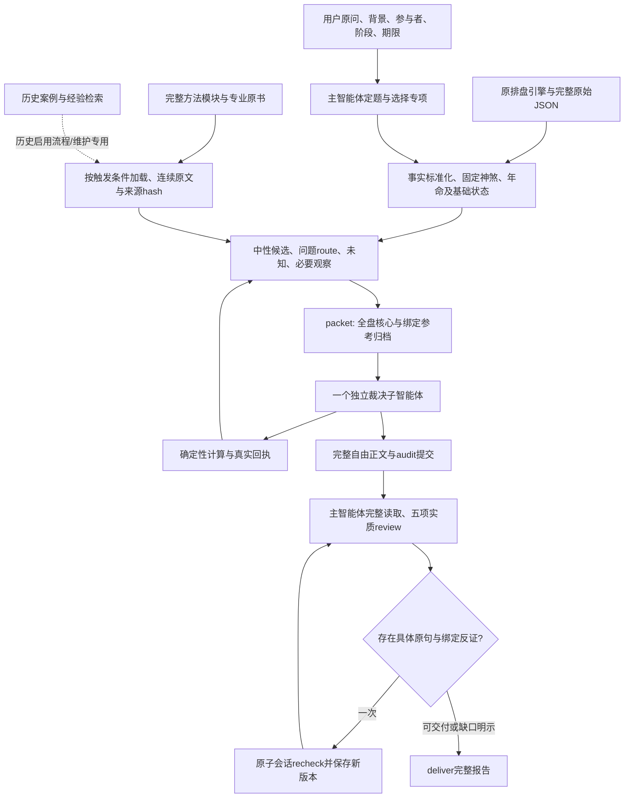

# 架构与完整工作流程

## 1. 架构的实际边界

系统是“专业规则与资料 + 确定性排盘/计算 + 宿主工具接口 + 主智能体中性准备 + 独立子智能体裁决 + 证据核对与完整交付”的组合。它不是一个单独 API，也不是把整库一次性塞入 Prompt 的单体脚本。Python 管理资料与检索；Node.js 运行原排盘、派生事实、计算、交接合同与状态机；OpenCode/Codex 宿主负责真实模型会话。

程序只核事实、查表、算数和数据约束。选取用神/类神、解释其在原问中的职责、判断有效制救与最终成败属于专业裁决。相关工具不会通过最高分自动选类，也不会把旺衰分解释成成功概率。

图中最后一条虚线是被保留的检索能力；55 与 62 的普通占断均禁止两库检索。62 在进入独立裁决前已经走另一条短答路线，不能用这张图声称 62 正在完整执行。

## 2. 两个宿主入口

| 入口 | 配置及指令 | 职责与真正的调用链 |
|---|---|---|
| Codex | `integrations/codex/daliuren-codex/SKILL.md`、`references/host.md`、项目 `AGENTS.md`、`docs/Codex大六壬工作流.md` | 用户说“使用大六壬进行测算”时启用；主准备，`tools/liuren-codex.mjs` 桥接原生子智能体及共享合同；原生 `collaboration.spawn_agent` 显式 `gpt-6.1-sol/high/fork_turns=none` |
| OpenCode | `opencode.json`、`.opencode/skills/liuren/*`、`.opencode/oh-my-opencode-slim.jsonc`、`.opencode/plugins/liuren-adjudication.ts`、`.opencode/tools/*.ts` | 注册受限资料/排盘/计算/交接工具；主用 `task` 派 `liuren-adjudicator`，固定 DeepSeek Flash/high；slim 插件管理子会话与结果传递 |

二者共用活动指针、规则、排盘、计算和核心交接实现，不互相嵌套。Codex 不调用 OpenCode 的 task，不套用 DeepSeek 的 393216 输出额度；OpenCode 不使用 Codex 的原生子智能体 ID。Codex 桥接通过 `bind` 记录真实原生 ID，但共享文件回执不能构成操作系统级隔离或独立认证。

OpenCode 完整配置中的主模型与裁决模型分别设置：主入口为 `conpera/gpt-6.1-sol`、high，裁决为 `deepseek/deepseek-flash`、high，完整裁决配置显式预算 393216。它们是本地配置值；本次没有验证供应商模型可用性或最大额度兑现。用户级配置的脱敏快照在 `external/`，不收集认证存储。

当前 62 的主 Prompt 明令短答，不读完整裁决三模块，不创建 packet/task，不做 review。恢复完整流程必须使用一套完整匹配的入口、权限、实现与指针；不能只把短 Prompt 换成一篇长文字。

## 3. 活动指针、冻结版本和动态加载

`.opencode/liuren-active.json` 指定 release、runtime、methodVersion、Skill 哈希、实现源码哈希、原书检索索引、采用神煞规则及实验开关。`load-liuren-methods.py` 的 `active/content/plan_steps` 读取指针与 `manifest.json`，校验正文身份，并处理精确登记的本机排盘操作覆盖项。运行中不是随意搜索整个 runtime 找最新版。

每个冻结 runtime 保存 `entry.md`、`manifest.json`、`reading-route.json`、`source-read-map.json`、`loader-contract.json`、methods/domains/references/details/procedures，以及迁移/整合/覆盖证据。`manifest.files` 是正文白名单与哈希；`modules` 是模块 ID 到文件、依赖和触发条件的映射；alias 是旧 ID 兼容，不是重复裁决轮次。

`source-read-map.json` 将历史引文绑定到精确原件和 hash；不是开放旧包全目录扫描。`loader-contract.json` 和指针中的实现 hash 可发现磁盘源码与已加载约定不一致；宿主进程重载还需新进程的真实 workflow ready 回执。磁盘校验不能证明一个已经运行的 OpenCode 进程热加载成功。

本包保留所有可读取的 `runtime/liuren/` 冻结版本，包括其中历史保留副本。旧包里偶有八字/出生推命等历史资产，只供溯源；不进入最新普通占断的活动计划。

最新保留的完整核心在62包中仍有55之后的修订：U02喜旺恶衰的数值执行解释与旺衰标签边界。17份完整专项以及adjudication/report与55对应原文字节相同；完整核心则不同。`full-design/`和逐行diff保留这一区别。下节用55解释可复现的完整执行链，不以此撤销后续已存在的专业资产。

## 4. 完整专业执行顺序（以 55 为完整基线）

### 4.1 检查与问题理解

Codex 跑 `node tools/liuren-codex.mjs status`；OpenCode 跑 `python -X utf8 tools/liuren-preflight.py` 并在新会话调用 `liuren_tool_help(topic=workflow,domains=[本问])`。保存用户原问，逐问区分事件、对象、阶段、截止期、成功标准与结果形式。原问明确、主推断、未知和盘推必须分别标识。

按实际事件选择 17 专项中的分支。招聘、升职、财务或关系等不能仅按一个关键词路由，更不能把“是否录用”改成“待遇好坏”，或把“经营概况”改成“何时回款”。路线写进 `input_review.questions[].route`：event、focus、primary_entity_ids、selection_basis、time_scope。

### 4.2 阅读专业规则并取得可信盘

准备阶段读取 `judgment-core`、`adjudication` 与本问 domain；交付前读 `report`。详细 positioning/liqi/void/structure/shensha-use/movement 及原书只在条件不足、适用分歧或反证缺口时触发。原规则全文都在包中，“按需读取”不是删除规则。

可信盘由原引擎生成并归档，传递原始 hash。原始 JSON 的自动断语与程序事实分开。完整十二宫、四课四槽、三传三槽、全宫神煞及来源身份不能被摘要替代。同输入且已核验的盘可复用，同卦续问只补新争点。

### 4.3 取用与盘面提取

主智能体按专项职责首取/有条件递补，记录来源和条件，不因旺弱、空亡或偏好结论改换更好看的类神。人物天盘类神与地盘本命/行年上的上神分开。关系题保留必要双方及关系，整体题可没有唯一单类。

`entities` 保存候选坐标和现实指代；`observations` 仅保留必要方法观察；`facts` 只补现实事实，不能手填“确定性事实”冒充程序输出。`focus_issues` 是真实未决问题，不能夹带主智能体完整判词。程序核对 ID、坐标与题目覆盖，不替代专业取用。

### 4.4 旺衰、整体气势与有效关系

先观察课势以确定本问侧重，再沿主类实际坐标察月令、地气、十二状态、空墓、乘将、课传与相互作用。理气贯穿；不是每套理论轮流给一票。区分施者状态、受者状态、通路、对象、作用环节、先后与能否兑现。

`strength/local-strength/palace-strength` 等程序计算已选对象及关系。单宫分不能代表完整关系链，月令值不能代替坐处十二气，数值较高不能自动消除闭口等专项条件。跨宫数值增减要用真实关系补算回执，不自动全盘联算。全部算法、参数 profile、实验性说明均保留。

### 4.5 吉凶综合、制救与冲突处理

支持与最强反证使用相同证据标准，明确哪一条件有效、救谁制谁、解除哪一障碍及作用多少。自身旺、吉名与现实结果已兑现分别判断；真实结论由所问事件与关键作用链形成。多个术语指向同一事实不能重复数票。课体、毕法和神煞作为有界辅助，不另开独立裁决轮次。

U01—U11 是已确认政策，历史 C 编号不是待确认列表；V41-01 依当前保留决定处理。具体内容见绑定 `judgment-core` 和 `confirmedJudgmentPolicy`，不能只根据本说明缩写重新实现规则。

### 4.6 年命、应期和数量

用户明确出生年、本命或行年时采用 `year_life/life`，无生日不弃用；缺性别只影响行年候选。出生推命与出生运限退出普通流程，长期占事和正常应期仍保留。

应期按原问实际形成/评定/公布/兑现节点，用 calendar/evaluation 验证候选；不按最高分自动择期。数量按 quantity、quantity-strength、quantity-correction 分 source/experimental 路径；先核原法适用性，再求基础数、旺衰与空的使用、量级、单位和例外，最后 `quantity_adjustment` 消费同 run 真实回执。非零进位、免空减等例外须有连续原文及本问应用说明；不能重复扣空或将名次机械折半。

### 4.7 中性交接和独立裁决

packet 校验原问逐字引句、问题/对象/route 与中性来源身份；从可信归档生成完整核心并绑定方法、原书段和计算材料。`core-with-bound-reference-archive` 保留完整盘核心，参考用 ID/hash 按需回读，避免派工消息装入巨量 JSON 而截断。

一个新任务只派一个独立裁决者。子智能体读完整核心，从全盘查漏，候选可以依据事实和规则纠正。OpenCode 的完整角色 Prompt 原文在 `.opencode/oh-my-opencode-slim.jsonc` 的 `agents.liuren-adjudicator.prompt`；Codex `role` 绑定专业角色并提供 host_mapping。完整配置与可读 Prompt 提取件都在包中。

裁决者逐问给直接结论、决定性依据、最强反证与取舍理由，完整自由正文加 audit 提交，成功后只回小回执。正文持久化，不用内部推理替代最终报告。读取回执证明工具输出，不证明语义理解。

### 4.8 五项核对、一次补核与忠实交付

主领取并读完整报告，五项 review 检查：原问事件/事实、首取在实判中的职责阶段、数法/量级及计算范围、有效反证/制救、逐问约束。evidence_refs 必须来自本任务已绑定 ID/回执；职责项覆盖每个 `route:问ID`。

具体报告原句与绑定证据支持真实问题时，原子会话 recheck 一次，保存 report 与 report-recheck。补核不预先锁结论或数字，不另派，不由主折中改判；剩余缺口登记并完整交付。格式错误只修格式。长度停止且无已保存正文时，按 next_call 原会话 recover 一次，仍无正文明确未完成。

`deliver` 绑定实际报告 hash 与 review，主忠实复述结论、数值、精度和条件。它是交付门禁，不是专业正确性证明。

## 5. Skill、依赖与按需组合

| Skill/机制 | 触发与职责 | 与其他部分的关系 |
|---|---|---|
| daliuren-codex | 明确占断及同卦续问 | Codex 总入口；调用完整方法、盘、计算、packet/原生子/review/deliver |
| daliuren | OpenCode 普通占事 | 完整版为主专业入口；62 同名入口被短答试验覆盖，须按版本区分 |
| liuren-cases | 案例查询、反馈、知识维护 | 独立维护入口；普通无两库占断不能借此绕取案例 |
| liuren-extract | 从原书/资料提取带条件的方法 | 调用 workbench、来源核对、规则/审查附加层；不自动启动预测裁决 |
| 历史分项 Skill/refs | 旧完整体系的细分方法 | 全文及迁移映射在冻结 runtime/来源快照中；新模块可能 alias/合并，不能同时叠加所有历史要求 |
| 原装 slim Skill/能力 | 宿主侧 task、task_result 与会话生命周期 | 固定插件发行代码附在 vendor；与本项目专业判断规则不是同一层 |

完整逐模块的文件、requires、required、trigger/when、别名与各版差异在 `audit/runtime-module-catalog.json` 及 Markdown 索引。它补足上表，不用简短表格替代原 Skill。课程写作、统筹、绘图和网站运营等未参与普通占断的 Skill 不作为必需依赖打包；被精确引用的毕法整理本则由引用闭包收入。

## 6. 状态矩阵与组合限制

| 能力 | 55 完整裁决基线 | 当前 62 OpenCode | 代码/设计保留情况 |
|---|---|---|---|
| 完整专业核心与17专项 | 执行 | 专项摘录参与短答；完整核心不走默认路线 | 各冻结包全文保留 |
| 独立子裁决、audit、review/deliver | 执行 | 默认禁止 | 共用实现与角色配置保留，Codex完整路线保留 |
| 原书精确检索 | 按需 | 条件不足时定点查询 | 七书索引及更广全文检索均保留 |
| 案例/经验检索 | 普通占断禁用 | 普通占断禁用 | 早期完整流程和维护工具保留 |
| 数量/分数/名次/应期 | 按问触发 | 暂停 | 完整算法、原法登记与例外保留 |
| 62 喜旺恶衰/五行月令试验解释 | 非55既有规则 | 执行 | 是试验语义，不反向合并为55已验规则 |
| 客户历史报告/真实任务缓存 | 任务原位保存 | 不进入普通材料范围 | 本包排除，用合成样例说明结构 |
| 外部模型/宿主安全隔离 | 需真实宿主运行 | 需真实宿主运行 | 不含平台源码、凭据或OS级隔离实现 |

历史发布记录称通过的工程测试仅作为历史证据；本次在导出副本中重做的验证另见报告。现有工作流没有提供已证实预测准确率。

## 7. 为什么这些机制必须一起看

只有规则而没有加载器，会丢失触发条件与版本身份；只有盘面而没有完整原 JSON，会丢失数据来源与错误定位；只有子 Prompt 而没有 packet/绑定/read/submit，会丢失真正的独立会话交接；只有历史文件而没有检索/排除/回读/注入协议，会误解记忆如何生效；只有报告正文而没有回执和 review，会无法区分已提交、被核对和仅有模型完成声明。

审计时应沿“原问 → 可信数据 → 本版规则 → 中性候选 → 已绑定证据 → 独立裁决 → 已保存报告 → 五项review → 原会话补核 → deliver”逐层核验。恢复历史两库检索时，还要将来源去重、已知同案排除、状态筛选与参考绑定接入；只把缓存文件复制进目录并不使检索自动启用。
